# Unwritten Chapters · Study Guides

**15 classic books. Cliff-notes study guides, short read-aloud study scripts, and 150 free sources from museums, archives and historic sites.**

Made for the *Unwritten Chapters* YouTube channel, where classic books get gentle "what-if" bedtime stories. These guides are the daytime companion: quick, clear and classroom-ready.

## What's in each guide

- The book in brief
- Who's who
- Big ideas
- Key quotes, with a plain-English line under each
- Words to know
- Our what-if (the channel's story)
- Discussion questions
- A classroom activity
- 10 sources: museums, archives, manuscripts, digital tours, first editions and free texts

## The guides

| | | |
|---|---|---|
| [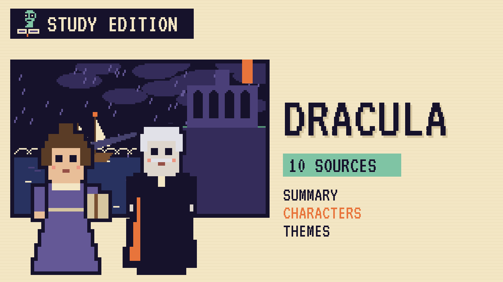](guides/E01-dracula.md) | [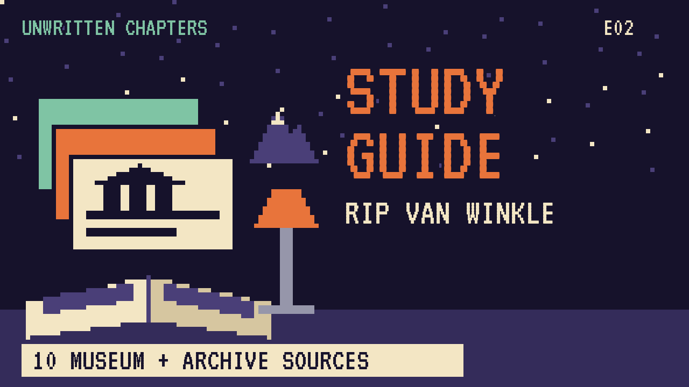](guides/E02-rip-van-winkle.md) | [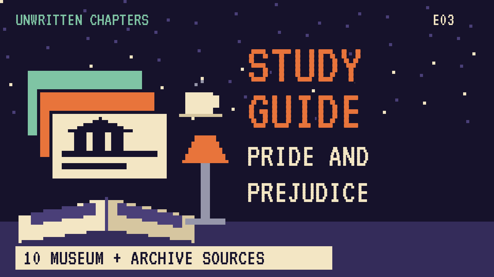](guides/E03-pride-and-prejudice.md) |
| **E01** [Dracula](guides/E01-dracula.md) · [script](scripts/E01-dracula-study-script.md) · [video](https://www.youtube.com/watch?v=YOUTUBE_ID_E01) | **E02** [Rip Van Winkle](guides/E02-rip-van-winkle.md) · [script](scripts/E02-rip-van-winkle-study-script.md) · [video](https://www.youtube.com/watch?v=YOUTUBE_ID_E02) | **E03** [Pride and Prejudice](guides/E03-pride-and-prejudice.md) · [script](scripts/E03-pride-and-prejudice-study-script.md) · [video](https://www.youtube.com/watch?v=YOUTUBE_ID_E03) |
| [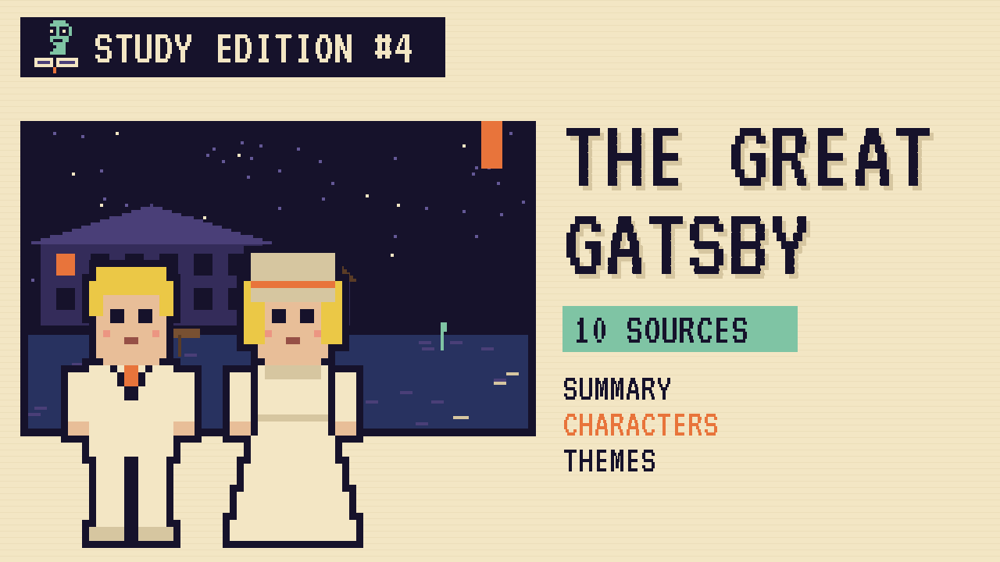](guides/E04-the-great-gatsby.md) | [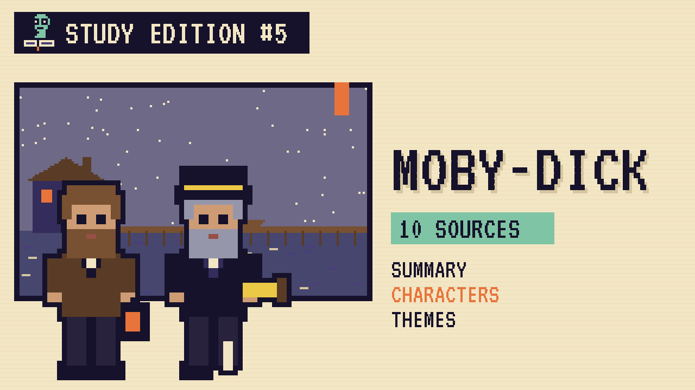](guides/E05-moby-dick.md) | [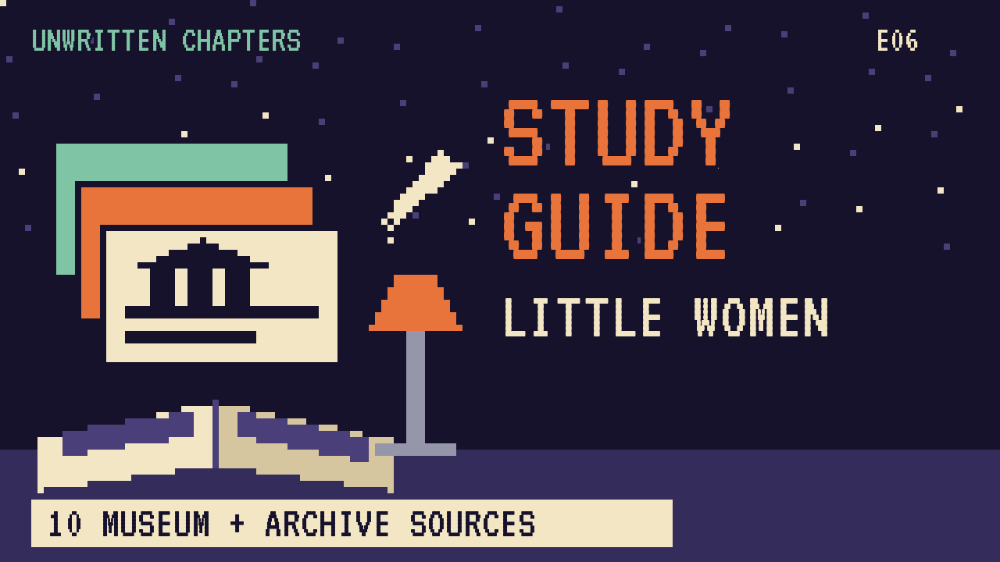](guides/E06-little-women.md) |
| **E04** [The Great Gatsby](guides/E04-the-great-gatsby.md) · [script](scripts/E04-the-great-gatsby-study-script.md) · [video](https://www.youtube.com/watch?v=YOUTUBE_ID_E04) | **E05** [Moby-Dick](guides/E05-moby-dick.md) · [script](scripts/E05-moby-dick-study-script.md) · [video](https://www.youtube.com/watch?v=YOUTUBE_ID_E05) | **E06** [Little Women](guides/E06-little-women.md) · [script](scripts/E06-little-women-study-script.md) · [video](https://www.youtube.com/watch?v=YOUTUBE_ID_E06) |
| [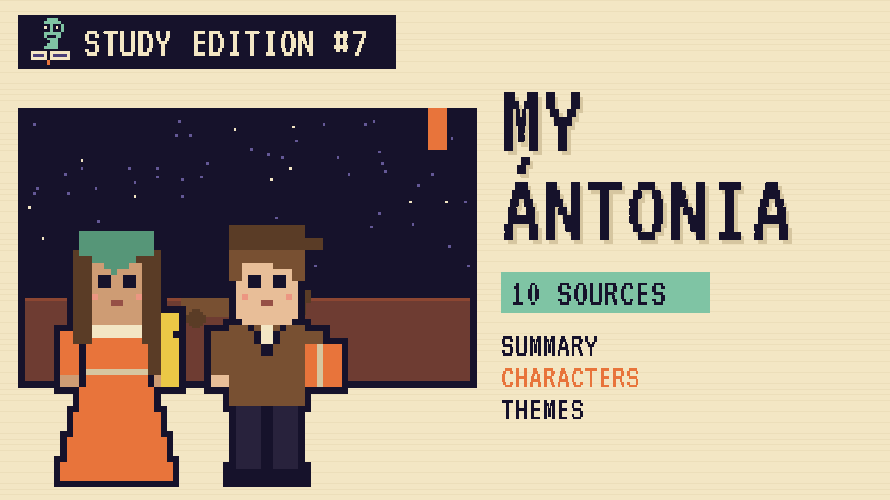](guides/E07-my-antonia.md) | [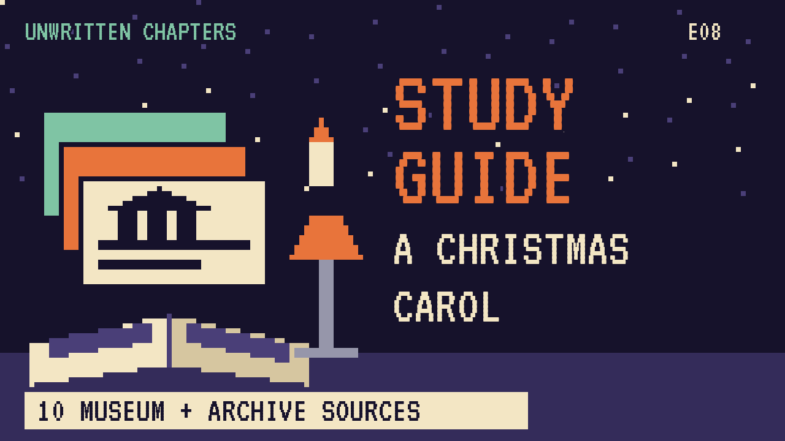](guides/E08-a-christmas-carol.md) | [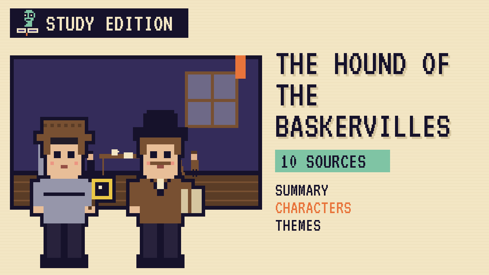](guides/E09-hound-of-the-baskervilles.md) |
| **E07** [My Ántonia](guides/E07-my-antonia.md) · [script](scripts/E07-my-antonia-study-script.md) · [video](https://www.youtube.com/watch?v=YOUTUBE_ID_E07) | **E08** [A Christmas Carol](guides/E08-a-christmas-carol.md) · [script](scripts/E08-a-christmas-carol-study-script.md) | **E09** [The Hound of the Baskervilles](guides/E09-hound-of-the-baskervilles.md) · [script](scripts/E09-hound-of-the-baskervilles-study-script.md) |
| [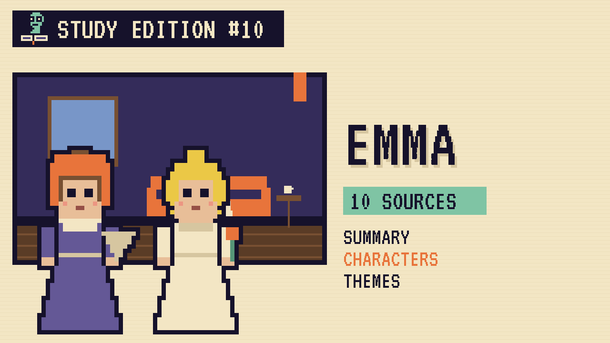](guides/E10-emma.md) | [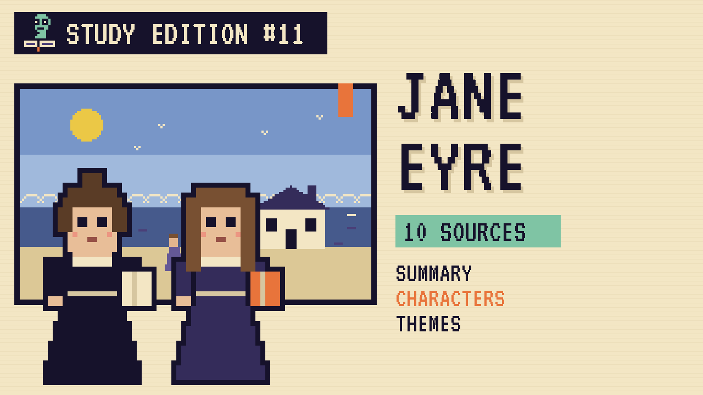](guides/E11-jane-eyre.md) | [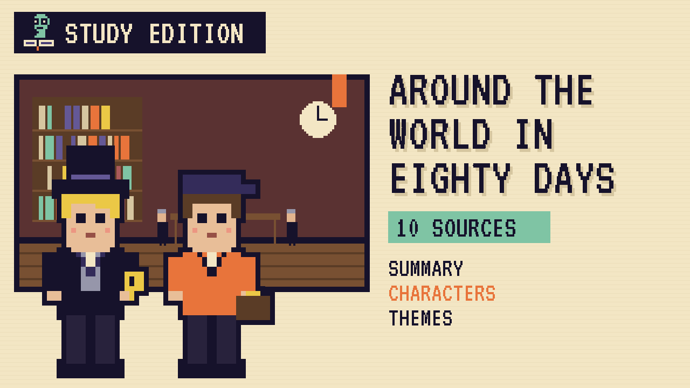](guides/E12-around-the-world-in-80-days.md) |
| **E10** [Emma](guides/E10-emma.md) · [script](scripts/E10-emma-study-script.md) | **E11** [Jane Eyre](guides/E11-jane-eyre.md) · [script](scripts/E11-jane-eyre-study-script.md) | **E12** [Around the World in Eighty Days](guides/E12-around-the-world-in-80-days.md) · [script](scripts/E12-around-the-world-in-80-days-study-script.md) |
| [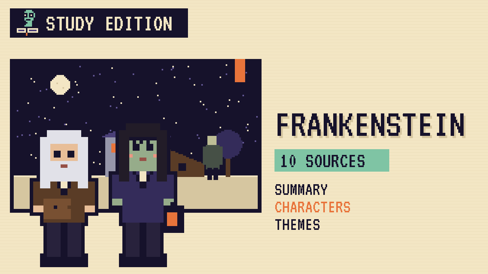](guides/E13-frankenstein.md) | [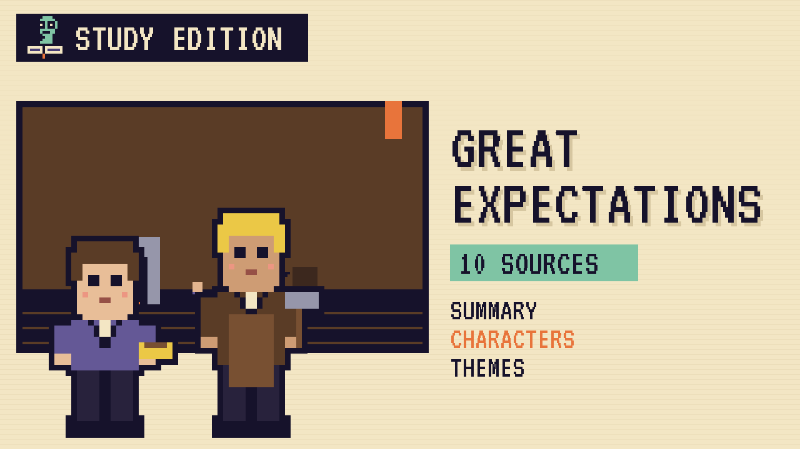](guides/E14-great-expectations.md) | [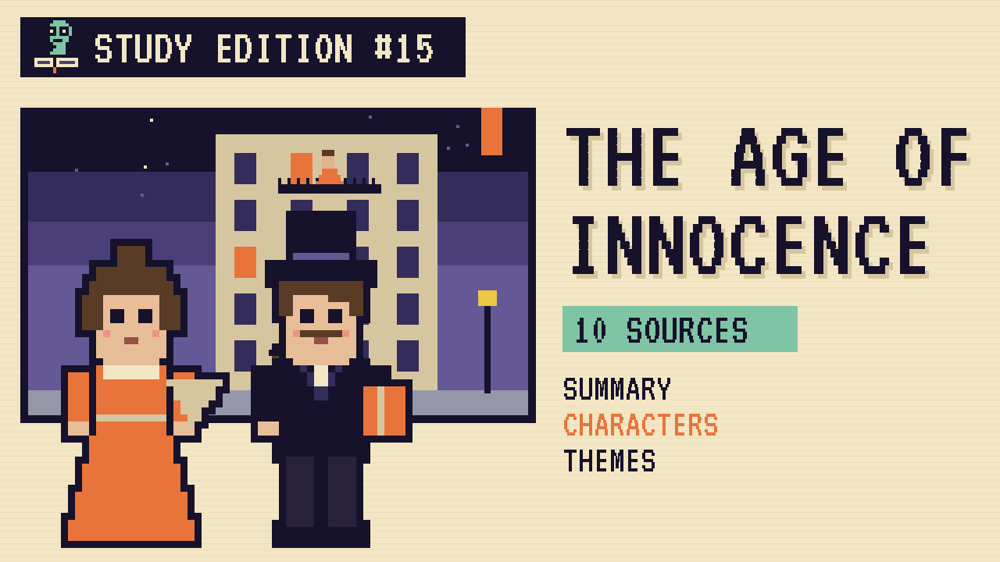](guides/E15-the-age-of-innocence.md) |
| **E13** [Frankenstein](guides/E13-frankenstein.md) · [script](scripts/E13-frankenstein-study-script.md) | **E14** [Great Expectations](guides/E14-great-expectations.md) · [script](scripts/E14-great-expectations-study-script.md) | **E15** [The Age of Innocence](guides/E15-the-age-of-innocence.md) · [script](scripts/E15-the-age-of-innocence-study-script.md) |

## Study Edition videos

Each Study Edition is an 8-bit video of about 8.5 minutes: the book in brief, our what-if story chapter by chapter, who's who, the big ideas, the author, the world of the book and the ten sources.

| | Guide | Video | Captions |
|---|---|---|---|
| E01 | [Dracula](guides/E01-dracula.md) | [Watch](https://www.youtube.com/watch?v=YOUTUBE_ID_E01) | [captions](captions/E01-dracula.srt) |
| E02 | [Rip Van Winkle](guides/E02-rip-van-winkle.md) | [Watch](https://www.youtube.com/watch?v=YOUTUBE_ID_E02) | [captions](captions/E02-rip-van-winkle.srt) |
| E03 | [Pride and Prejudice](guides/E03-pride-and-prejudice.md) | [Watch](https://www.youtube.com/watch?v=YOUTUBE_ID_E03) | [captions](captions/E03-pride-and-prejudice.srt) |
| E04 | [The Great Gatsby](guides/E04-the-great-gatsby.md) | [Watch](https://www.youtube.com/watch?v=YOUTUBE_ID_E04) | [captions](captions/E04-the-great-gatsby.srt) |
| E05 | [Moby-Dick](guides/E05-moby-dick.md) | [Watch](https://www.youtube.com/watch?v=YOUTUBE_ID_E05) | [captions](captions/E05-moby-dick.srt) |
| E06 | [Little Women](guides/E06-little-women.md) | [Watch](https://www.youtube.com/watch?v=YOUTUBE_ID_E06) | [captions](captions/E06-little-women.srt) |
| E07 | [My Ántonia](guides/E07-my-antonia.md) | [Watch](https://www.youtube.com/watch?v=YOUTUBE_ID_E07) | [captions](captions/E07-my-antonia.srt) |

The video files live on YouTube, not in this repo. After uploading, add the IDs to `tools/links.json` and run `python3 tools/set_links.py`.

## Folders

| Folder | What's inside |
|---|---|
| `guides/` | 15 cliff-notes guides in Markdown, readable right here on GitHub |
| `scripts/` | 15 Study Edition scripts, about 8.5 minutes each, written to be read aloud |
| `captions/` | English captions (.srt) for the published Study Edition videos |
| `tools/set_links.py` | Fills in the YouTube video IDs after you upload |
| `assets/thumbnails/` | 8-bit thumbnails, 1280 × 720, ready for YouTube |
| `docs/` | The same guides as an 8-bit styled website for GitHub Pages |
| `resources.md` | All 150 sources in one list |

## Publish the website

1. Push this folder to a new GitHub repository.
2. Go to **Settings → Pages**, choose **Deploy from a branch**, pick `main` and the `/docs` folder.
3. Your site appears at `https://<your-username>.github.io/<repo-name>/`.

## Link checking

Museum websites move pages from time to time. The workflow in `.github/workflows/links.yml` checks every link once a month and on every push. If a link breaks, the run turns red and lists it.

## Brand

Midnight `#16122B` · Dusk `#4A3F78` · Vellum `#F3E6C4` · Ember `#E8743B` · Moss `#7FC4A4` · Display font: VT323.

## License

Guides, scripts and thumbnails: [CC BY 4.0](https://creativecommons.org/licenses/by/4.0/). Teachers may copy, adapt and share them with credit to *Unwritten Chapters*. All book quotations come from public-domain texts.
