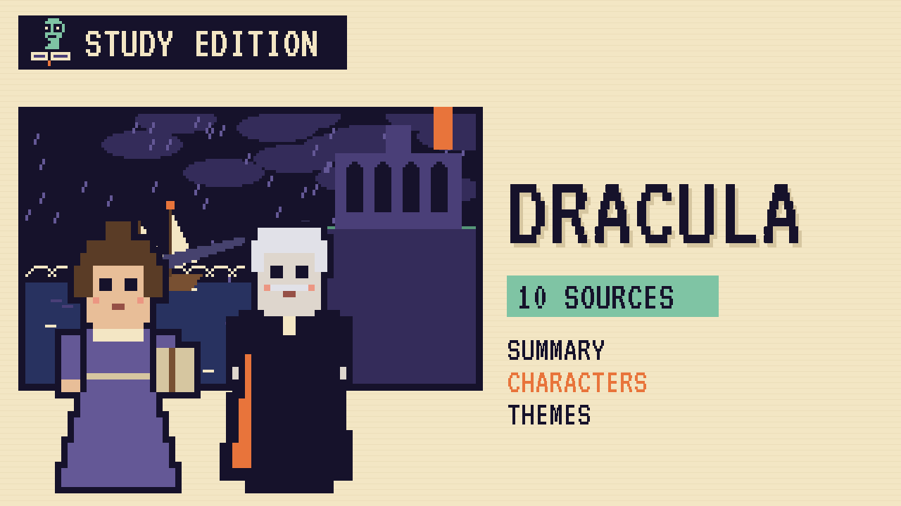

# Dracula
### Unwritten Chapters Study Guide · E01 · "Mina Keeps Watch"

| | |
|---|---|
| **Author** | Bram Stoker |
| **Published** | 1897 |
| **Setting** | Transylvania, Whitby and London, 1890s |
| **Free text** | [Project Gutenberg](https://www.gutenberg.org/ebooks/345) |
| **Study script** | [Read-aloud script](../scripts/E01-dracula-study-script.md) |
| **Video** | [Watch the 8.5-minute Study Edition](https://www.youtube.com/watch?v=YOUTUBE_ID_E01) · [captions](../captions/E01-dracula.srt) |

> In Dracula, a ship drifts into Whitby harbour in a storm with fifty boxes of earth on board, and Mina Murray reads all about it in the newspaper. This guide covers the novel and a version where she reads it twice.

## The book in brief

*Dracula* is told in diaries, letters, telegrams and newspaper cuttings. It begins with a young English solicitor's clerk, Jonathan Harker, travelling to Transylvania to help Count Dracula buy a house in England, an old place called Carfax. At the castle, Jonathan slowly realises he's a prisoner.

The Count sails to England on a Russian ship called the *Demeter*. It crashes onto the beach at Whitby in a storm, with its captain dead and tied to the wheel. A huge dog leaps ashore, and the cargo is fifty boxes of earth. Jonathan's fiancée, Mina Murray, is staying in Whitby with her friend Lucy Westenra, who begins to walk in her sleep and fall ill.

Dr John Seward sends for his old teacher, Professor Abraham Van Helsing. With Lucy's friends, and with Mina's careful notes, they track down the boxes one by one and make them useless to the Count. In the end they follow him home to Transylvania.

## Read-along: how the book begins

[warmly, clearly]

Here's a short taste of the real thing. Listen to how the language sounds.

[Quote card shows the passage line by line.]

*3 May. Bistritz.*--Left Munich at 8:35 P. M., on 1st May, arriving at Vienna early next morning; should have arrived at 6:46, but train was an hour late. Buda-Pesth seems a wonderful place, from the glimpse which I got of it from the train and the little I could walk through the streets. I feared to go very far from the station, as we had arrived late and would start as near the correct time as possible. The impression I had was that we were leaving the West and entering the East; the most western of splendid bridges over the Danube, which is here of noble width and depth, took us among the traditions of Turkish rule.

[brightly]

The words are old, but you can already hear the voice of the book.

[Beat. Music sting.]

## Who's who

- **Mina Murray**: An assistant schoolmistress who's learning shorthand. She notices everything and writes it all down.
- **Jonathan Harker**: Mina's fiancé, a solicitor's clerk sent to Transylvania on business.
- **Lucy Westenra**: Mina's best friend, who receives three marriage proposals in one day.
- **Abraham Van Helsing**: A Dutch professor who knows more about old, strange things than anyone alive.
- **Dr John Seward**: A young doctor who runs a hospital next door to Carfax.
- **Count Dracula**: An ancient nobleman from Transylvania who travels to England with boxes of his own soil.

## Big ideas

- **Careful noticing.** Mina wins by reading closely, making lists and checking facts. Her careful work shows that patience can be a kind of courage.
- **Stories inside stories.** The book is a pile of diaries, letters and news cuttings. Each writer knows only part of the truth until the pieces are put together.
- **Old and new.** The Count is ancient, but his hunters use trains, telegrams, typewriters and shorthand. Modern tools help them win.
- **Teamwork.** No one in the book wins alone. The friends succeed by sharing what they know.

## Key quotes

> "I shall try to do what I see lady journalists do: interviewing and writing descriptions and trying to remember conversations."  
> — *Dracula*, 1897, chapter 5

*In plain words:* Mina's plan to notice and record everything.

> "Right over the town is the ruin of Whitby Abbey."  
> — *Dracula*, 1897, chapter 6

*In plain words:* Mina describing Whitby from the cliff.

> "Welcome to my house! Enter freely and of your own will!"  
> — *Dracula*, 1897, chapter 2

*In plain words:* The Count's famous greeting to Jonathan Harker.

## Words to know

| Word | Meaning |
|---|---|
| shorthand | a fast way of writing using symbols instead of whole words |
| solicitor | a British lawyer who handles paperwork and property |
| schooner | a sailing ship with two or more masts |
| consigned | sent to a particular person to look after |
| folklore | old beliefs and stories passed down by ordinary people |

## Our what-if: "Mina Keeps Watch"

In our story, Mina reads the *Demeter*'s log in the newspaper and doesn't turn the page. She makes a list, visits the Whitby solicitor who took charge of the cargo, and learns that all fifty boxes are going by train to Carfax, the house Jonathan went abroad to sell, right next to Dr Seward's hospital.

She writes to Dr Seward, who sends for Van Helsing straight away. Lucy is kept safe, the friends find all fifty boxes together in the old chapel at Carfax, and the Count leaves England quietly on the *Czarina Catherine*. Mina goes to Budapest to marry Jonathan, just as she does in the book.

## Discussion questions

1. Why do you think Stoker tells the story through diaries and letters instead of one narrator?
2. In our story, Mina reads the same newspaper as everyone else. What does she do differently?
3. Which modern tools of the 1890s help the friends, and how?
4. Why do you think the friends never fight the Count directly in our version?

## Activity

Keep Mina's journal. Write one page of Mina's journal for the day after the storm, using only facts from the guide, and end it with her list.

## 10 sources: museums, archives and primary sources

| # | Source | Type | Why it's useful |
|---|---|---|---|
| 1 | [Bram Stoker's notes for *Dracula* (facsimile)](https://archive.org/details/bramstokersnotes0000stok) | Manuscript | Stoker's own planning notes, including his research on Whitby. |
| 2 | [The Rosenbach, Philadelphia](https://rosenbach.org/) | Museum | The museum and library that owns Stoker's original notes for *Dracula*. |
| 3 | [Whitby Abbey (English Heritage)](https://www.english-heritage.org.uk/visit/places/whitby-abbey/) | Historic site | The ruined abbey on the East Cliff that Mina describes. |
| 4 | [Whitby Museum](https://whitbymuseum.org.uk/) | Museum | Local history of the town, its ships and its sailors. |
| 5 | [British Library: *Dracula*](https://www.bl.uk/works/dracula) | Archive | Articles and digitised items about the novel and its world. |
| 6 | [Historic England](https://historicengland.org.uk/) | Archive | Search for Whitby's abbey, church and harbour in the national list. |
| 7 | [The Victorian Web](https://victorianweb.org/) | Archive | Essays on Victorian society, science and the gothic. |
| 8 | [1897 first edition scans](https://archive.org/search?query=dracula+1897) | First edition | Early printings of the novel, scanned page by page. |
| 9 | [LibriVox audiobook](https://librivox.org/search?q=dracula) | Audio | Free volunteer readings of the novel. |
| 10 | [*Dracula* (free text)](https://www.gutenberg.org/ebooks/345) | Free text | The full novel, free to read. |

---
*Part of the [Unwritten Chapters Study Guides](../README.md). Free for classroom use under CC BY 4.0.*
