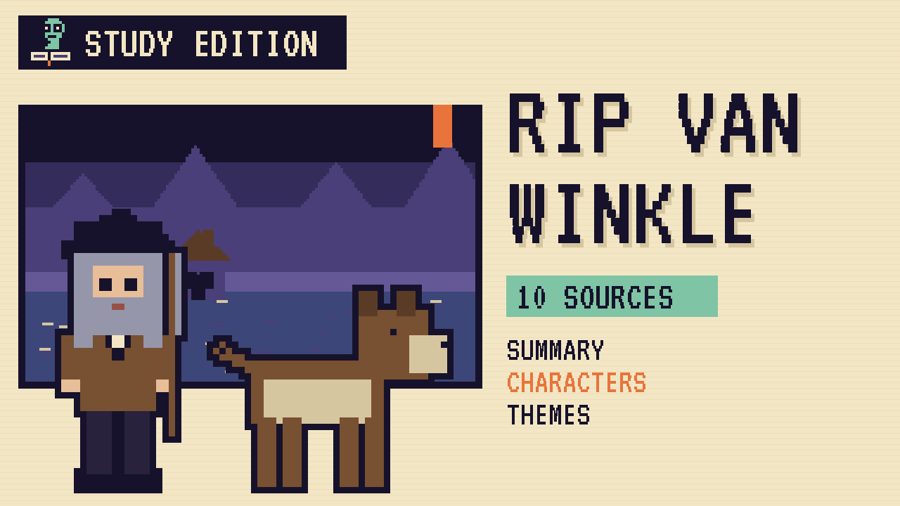

# Rip Van Winkle
### Unwritten Chapters Study Guide · E02 · "Just One Night"

| | |
|---|---|
| **Author** | Washington Irving |
| **Published** | 1819 |
| **Setting** | The Catskill Mountains, New York, before and after the American Revolution |
| **Free text** | [Project Gutenberg](https://www.gutenberg.org/ebooks/2048) |
| **Study script** | [Read-aloud script](../scripts/E02-rip-van-winkle-study-script.md) |
| **Video** | [Watch the 8.5-minute Study Edition](https://www.youtube.com/watch?v=YOUTUBE_ID_E02) · [captions](../captions/E02-rip-van-winkle.srt) |

> America's most famous sleep story is about a man who naps for twenty years. This guide covers Irving's tale and a version where Rip sleeps for only one night.

## The book in brief

Rip Van Winkle is a kind, lazy man in a Dutch village at the foot of the Catskill Mountains. He'll help anyone with their work but never does his own, and his wife scolds him constantly.

One autumn day he walks up into the mountains with his dog, Wolf. A strange little man asks for help carrying a keg, and leads him to a hollow where men in old Dutch clothes are silently playing ninepins. Rip drinks from their flagon and falls asleep.

He wakes twenty years later. His gun has rusted, his dog is gone, and his beard is a foot long. In the village, King George's picture on the inn sign has become General Washington. The American Revolution has come and gone while he slept.

## Read-along: how the book begins

[warmly, clearly]

Here's a short taste of the real thing. Listen to how the language sounds.

[Quote card shows the passage line by line.]

A POSTHUMOUS WRITING OF DIEDRICH KNICKERBOCKER.

By Woden, God of Saxons, From whence comes Wensday, that is Wodensday, Truth is a thing that ever I will keep Unto thylke day in which I creep into My sepulchre-- CARTWRIGHT.

[brightly]

The words are old, but you can already hear the voice of the book.

[Beat. Music sting.]

## Who's who

- **Rip Van Winkle**: A good-natured villager who avoids work and loves telling stories.
- **Dame Van Winkle**: Rip's wife, who has to run the farm he neglects.
- **Wolf**: Rip's loyal dog.
- **The little men**: Ghostly sailors said to be Henry Hudson's crew from the ship the *Half Moon*.

## Big ideas

- **Time and change.** The village changes from a British colony to part of the United States while Rip sleeps. Irving shows history happening to ordinary people.
- **Identity.** When Rip says "I'm not myself," he means the world has changed so much he doesn't know where he fits.
- **Responsibility.** It asks what Rip would do with a warning instead of twenty lost years.
- **How stories grow.** Irving pretends the tale was found in an old historian's papers. It shows how a story grows bigger each time it's told.

## Key quotes

> "Whoever has made a voyage up the Hudson must remember the Kaatskill mountains."  
> — "Rip Van Winkle," 1819

*In plain words:* Irving's opening line, inviting the reader into a real place.

> "I'm not myself—I'm somebody else."  
> — "Rip Van Winkle," 1819

*In plain words:* Rip is so confused he isn't sure who he is.

## Words to know

| Word | Meaning |
|---|---|
| ninepins | an old bowling game with nine wooden pins |
| flagon | a large jug for drink |
| barometer | a tool that predicts the weather |
| knoll | a small round hill |

## Our what-if: "Just One Night"

In our story, Rip takes only one small sip and sleeps for a single night. But he dreams the whole twenty years, and wakes up knowing what he'd lose.

He walks home, kisses his wife, and mends the fence. He stays awake for all of it, the war, the new flag, his children growing up. As an old man he tells the children about his strange night, and over the years the story grows into the twenty-year version that Irving wrote down.

## Discussion questions

1. Why do you think Irving chose twenty years as the length of Rip's sleep?
2. What does the change on the inn sign tell readers about what happened while Rip slept?
3. In our version Rip changes after a dream. Is a warning as powerful as a real loss?
4. Is Rip a hero, a warning, or just a funny character? Explain your answer.

## Activity

Make a then-and-now chart. List five things Rip would notice had changed in his village after twenty years, using details from Irving's story.

## 10 sources: museums, archives and primary sources

| # | Source | Type | Why it's useful |
|---|---|---|---|
| 1 | [Washington Irving's Sunnyside (Historic Hudson Valley)](https://hudsonvalley.org/historic-sites/washington-irvings-sunnyside) | Historic site | Irving's own riverside cottage in Tarrytown, New York, with tours and history. |
| 2 | [Sunnyside, Hudson River Valley National Heritage Area](https://www.hudsonrivervalley.org/sunnyside) | Historic site | Background on the house and the grounds Irving designed. |
| 3 | [Thomas Cole National Historic Site](https://thomascole.org/) | Museum | The home of the painter who made the Catskills famous in art. |
| 4 | [Hudson River School essay, The Met](https://www.metmuseum.org/toah/hd/hurs/hd_hurs.htm) | Museum | Paintings of the same mountains Irving wrote about. |
| 5 | [NYPL Digital Collections](https://digitalcollections.nypl.org/) | Archive | Search for historic prints and maps of the Catskills and Hudson. |
| 6 | [Library of Congress Maps](https://www.loc.gov/maps/) | Primary source | Colonial and early American maps of the Hudson Valley. |
| 7 | [Hudson River Valley Heritage](https://hrvh.org/) | Archive | Digitized photos, letters and newspapers from Hudson Valley libraries. |
| 8 | [*The Sketch Book*, early editions](https://archive.org/search?query=sketch+book+geoffrey+crayon) | First edition | Scans of the book where "Rip Van Winkle" first appeared. |
| 9 | [LibriVox audiobook](https://librivox.org/search?q=rip+van+winkle) | Audio | Free volunteer readings of the story. |
| 10 | [*The Sketch Book* (free text)](https://www.gutenberg.org/ebooks/2048) | Free text | The full collection, including "Rip Van Winkle." |

---
*Part of the [Unwritten Chapters Study Guides](../README.md). Free for classroom use under CC BY 4.0.*
