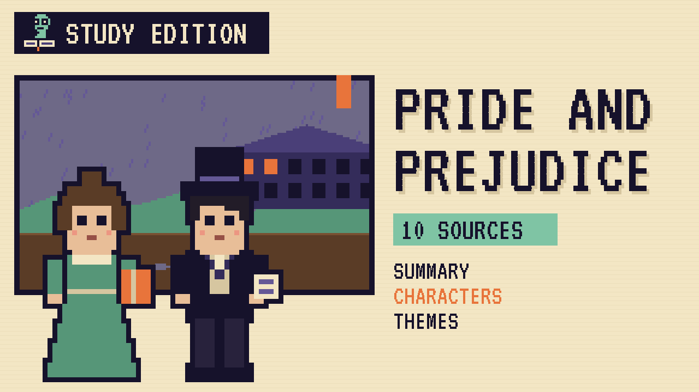

# Pride and Prejudice
### Unwritten Chapters Study Guide · E03 · "A Longer Stay at Netherfield"

| | |
|---|---|
| **Author** | Jane Austen |
| **Published** | 1813 |
| **Setting** | Hertfordshire, England, about 1811 |
| **Free text** | [Project Gutenberg](https://www.gutenberg.org/ebooks/1342) |
| **Study script** | [Read-aloud script](../scripts/E03-pride-and-prejudice-study-script.md) |
| **Video** | [Watch the 8.5-minute Study Edition](https://www.youtube.com/watch?v=YOUTUBE_ID_E03) · [captions](../captions/E03-pride-and-prejudice.srt) |

> Elizabeth Bennet and Mr Darcy almost don't get together, because they judge each other too fast. This guide covers the novel and a version where a rainy week gives them time to talk.

## The book in brief

Mrs Bennet has five daughters and no sons, so the family home will go to a cousin when Mr Bennet dies. She badly wants her girls to marry well. When a rich young man, Mr Bingley, rents Netherfield Hall nearby, she gets very excited.

Bingley falls for the eldest daughter, Jane. His proud friend Mr Darcy insults the second daughter, Elizabeth, at a ball, and she decides she dislikes him. A charming officer, Mr Wickham, tells her a false story about Darcy, and she believes it.

Darcy proposes, and Elizabeth turns him down angrily. He writes her a letter explaining the truth about Wickham. Slowly each of them sees their own pride and prejudice, and when Darcy quietly saves her family from scandal, she realises she loves him.

## Read-along: how the book begins

[warmly, clearly]

Here's a short taste of the real thing. Listen to how the language sounds.

[Quote card shows the passage line by line.]

At five o’clock the two ladies retired to dress, and at half-past six Elizabeth was summoned to dinner. To the civil inquiries which then poured in, and amongst which she had the pleasure of distinguishing the much superior solicitude of Mr. Bingley, she could not make a very favourable answer. Jane was by no means better. The sisters, on hearing this, repeated three or four times how much they were grieved, how shocking it was to have a bad cold, and how excessively they disliked being ill themselves; and then thought no more of the matter: and their indifference towards Jane, when not immediately before them, restored Elizabeth to the enjoyment of all her original dislike.

[brightly]

The words are old, but you can already hear the voice of the book.

[Beat. Music sting.]

## Who's who

- **Elizabeth Bennet**: Clever and quick to judge. She's the second of five sisters.
- **Fitzwilliam Darcy**: A rich, proud, shy man who's bad at talking to strangers.
- **Jane Bennet**: The eldest sister, gentle and kind.
- **Charles Bingley**: Darcy's cheerful friend, who rents Netherfield.
- **Caroline Bingley**: Bingley's sister, who wants to marry Darcy herself.
- **Mrs Bennet**: The girls' mother, who's anxious to see them married.

## Big ideas

- **First impressions.** Austen's first title for the book was *First Impressions*. Both main characters judge too quickly.
- **Pride and prejudice.** Darcy's pride and Elizabeth's prejudice both get in the way. Each has a bit of both.
- **Marriage and money.** Women in 1811 often couldn't inherit property, so marriage decided a woman's future.
- **Time to know someone.** The book suggests that people often change their minds once they really get to know each other.

## Key quotes

> "It is a truth universally acknowledged, that a single man in possession of a good fortune, must be in want of a wife."  
> — *Pride and Prejudice*, 1813, chapter 1

*In plain words:* Austen's joke that everyone assumes a rich, single man must want a wife.

> "My good opinion once lost, is lost for ever."  
> — *Pride and Prejudice*, 1813, chapter 11

*In plain words:* Darcy admits he doesn't forgive easily.

## Words to know

| Word | Meaning |
|---|---|
| entailed | property that must pass to a male heir |
| tolerable | just acceptable, nothing special |
| countenance | a person's face or expression |
| civility | polite behaviour |

## Our what-if: "A Longer Stay at Netherfield"

In the book, Jane falls ill at Netherfield and Elizabeth stays a few days to nurse her. In our story the rain doesn't stop, and they stay more than a week.

Elizabeth and Darcy end up alone in the library, where he makes his first joke. Later she sees him gently rewriting a letter to his young sister. So when Wickham tells his story, a small voice in her head isn't sure. The book's big events still happen, but a little sooner and more kindly.

## Discussion questions

1. What is Elizabeth's first impression of Darcy, and what causes it?
2. Who in the novel is guilty of pride, and who is guilty of prejudice? Can someone be both?
3. In our version, what one small thing Elizabeth sees changes how she hears Wickham's story?
4. Why did marriage matter so much to the Bennet sisters' futures?

## Activity

Write Darcy's letter. Using only facts from the book, write a short, calm letter from Darcy explaining himself to Elizabeth, in your own words.

## 10 sources: museums, archives and primary sources

| # | Source | Type | Why it's useful |
|---|---|---|---|
| 1 | [Jane Austen's Fiction Manuscripts Digital Edition](https://janeausten.ac.uk/) | Manuscript | Austen's surviving handwritten fiction, scanned page by page. |
| 2 | [Jane Austen's House, Chawton](https://janeaustens.house/) | Museum | The cottage where Austen revised *Pride and Prejudice* for publication. |
| 3 | [Chawton House](https://chawtonhouse.org/) | Historic site | Her brother's estate, now a library of early women's writing. |
| 4 | [Jane Austen Centre, Bath](https://janeausten.co.uk/) | Museum | Austen's Bath years and Regency daily life. |
| 5 | [Lyme Park (National Trust)](https://www.nationaltrust.org.uk/visit/peak-district-derbyshire/lyme) | Historic site | A great house often used to picture Pemberley. |
| 6 | [The Met Collection: Regency fashion](https://www.metmuseum.org/art/collection) | Museum | Search "1810 dress" for real clothes from Austen's time. |
| 7 | [Jane Austen Society of North America](https://jasna.org/) | Archive | Essays, maps and a free online journal, *Persuasions On-Line*. |
| 8 | [1813 first edition scans](https://archive.org/search?query=pride+and+prejudice+1813) | First edition | See how the book looked in its first printing. |
| 9 | [LibriVox audiobook](https://librivox.org/search?q=pride+and+prejudice) | Audio | Free volunteer readings. |
| 10 | [*Pride and Prejudice* (free text)](https://www.gutenberg.org/ebooks/1342) | Free text | The complete novel. |

---
*Part of the [Unwritten Chapters Study Guides](../README.md). Free for classroom use under CC BY 4.0.*
