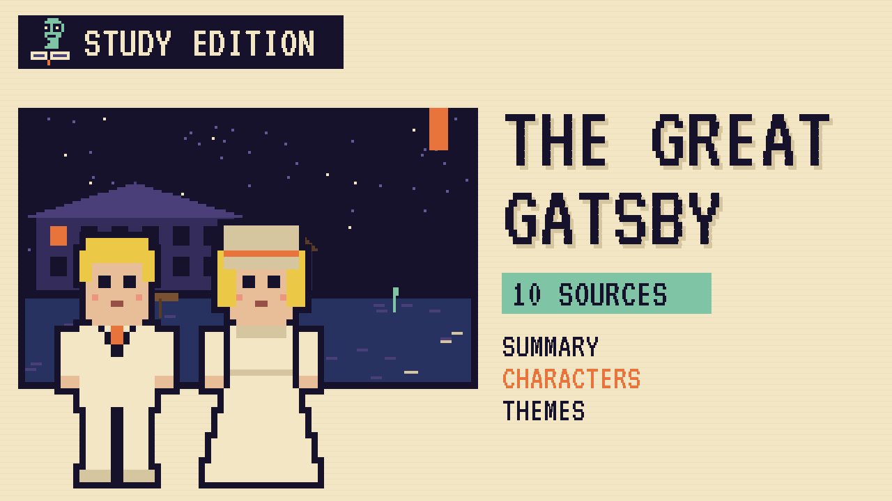

# The Great Gatsby
### Unwritten Chapters Study Guide · E04 · "Tea Before the Parties"

| | |
|---|---|
| **Author** | F. Scott Fitzgerald |
| **Published** | 1925 |
| **Setting** | Long Island and New York City, summer 1922 |
| **Free text** | [Project Gutenberg](https://www.gutenberg.org/ebooks/64317) |
| **Study script** | [Read-aloud script](../scripts/E04-the-great-gatsby-study-script.md) |
| **Video** | [Watch the 8.5-minute Study Edition](https://www.youtube.com/watch?v=YOUTUBE_ID_E04) · [captions](../captions/E04-the-great-gatsby.srt) |

> Jay Gatsby throws huge parties to win back Daisy Buchanan. This guide covers the novel and a version where he simply knocks on a door and asks her to tea.

## The book in brief

Nick Carraway moves to West Egg, on Long Island, and rents a small house next to the mansion of the mysterious Jay Gatsby. Across the bay lives Nick's cousin Daisy and her husband, Tom Buchanan.

Gatsby throws giant parties every weekend. Nick learns that Gatsby and Daisy loved each other five years earlier, before the war, and that everything Gatsby owns is meant to win her back. Nick arranges for them to meet again over tea.

Gatsby wants to repeat the past exactly. The summer ends in a car accident, a death, and a funeral almost nobody attends. Nick goes home to the Midwest, thinking about the green light at the end of Daisy's dock.

## Read-along: how the book begins

[warmly, clearly]

Here's a short taste of the real thing. Listen to how the language sounds.

[Quote card shows the passage line by line.]

When I came home to West Egg that night I was afraid for a moment that my house was on fire. Two o’clock and the whole corner of the peninsula was blazing with light, which fell unreal on the shrubbery and made thin elongating glints upon the roadside wires. Turning a corner, I saw that it was Gatsby’s house, lit from tower to cellar.

At first I thought it was another party, a wild rout that had resolved itself into “hide-and-go-seek” or “sardines-in-the-box” with all the house thrown open to the game. But there wasn’t a sound. Only wind in the trees, which blew the wires and made the lights go off and on again as if the house had winked into the darkness. As my taxi groaned away I saw Gatsby walking toward me across his lawn.

[brightly]

The words are old, but you can already hear the voice of the book.

[Beat. Music sting.]

## Who's who

- **Nick Carraway**: The narrator, a young bond salesman who tries not to judge people.
- **Jay Gatsby**: A rich, mysterious man who's spent five years trying to win back Daisy.
- **Daisy Buchanan**: Nick's cousin, Gatsby's old love.
- **Tom Buchanan**: Daisy's wealthy, bullying husband.
- **Pammy**: Daisy and Tom's young daughter.

## Big ideas

- **The past.** Gatsby believes you can repeat the past. The book suggests you can't.
- **The American Dream.** Gatsby rebuilt himself from nothing. Fitzgerald asks whether money can buy what he really wants.
- **Appearances.** The parties, the shirts and the mansion are all part of a show.
- **Letting go.** The book asks whether Gatsby could ever stop reaching for the green light.

## Key quotes

> "Whenever you feel like criticizing any one, just remember that all the people in this world haven't had the advantages that you've had."  
> — *The Great Gatsby*, 1925, chapter 1

*In plain words:* Nick's father's advice to be slow to judge.

> "Can't repeat the past? Why of course you can!"  
> — *The Great Gatsby*, 1925, chapter 6

*In plain words:* Gatsby refuses to accept that time moves on.

> "So we beat on, boats against the current, borne back ceaselessly into the past."  
> — *The Great Gatsby*, 1925, chapter 9

*In plain words:* We keep pushing forward while the past pulls us back.

## Words to know

| Word | Meaning |
|---|---|
| bond | a kind of loan sold to investors |
| Jazz Age | the 1920s in America, named after its music |
| ceaselessly | without ever stopping |
| flannel | a soft woven fabric |

## Our what-if: "Tea Before the Parties"

In our story, Gatsby asks Nick for the tea in June, in person, with no parties first. The meeting goes the same way, awkward then joyful, but the summer stays quiet.

Daisy brings her small daughter, Pammy, and Gatsby finally sees that Daisy has a life he wasn't part of. He says goodbye kindly and drives west to start again. The book's tragedy never happens.

## Discussion questions

1. What does the green light mean to Gatsby at the start, and does its meaning change?
2. Why does Gatsby throw parties he doesn't enjoy?
3. In our version, why does seeing Pammy change Gatsby's mind?
4. Nick tries not to judge people. Does he manage it?

## Activity

Map the bay. Draw West Egg, East Egg and the green light, and mark three key scenes from the novel on your map.

## 10 sources: museums, archives and primary sources

| # | Source | Type | Why it's useful |
|---|---|---|---|
| 1 | [Princeton "Gatsby 100" digital exhibit](https://dpul.princeton.edu/gatsby100/feature/princeton-s-fitzgerald-collections) | Digital tour | An online exhibition of Princeton's Fitzgerald collections. |
| 2 | [The handwritten Gatsby manuscript and galleys](https://www.princeton.edu/news/2013/05/24/great-gatsby-manuscript-and-galleys-now-online-through-princeton-university-digital) | Manuscript | Fitzgerald's draft, with his own crossings-out, now online. |
| 3 | [F. Scott Fitzgerald Papers, finding aid](https://findingaids.princeton.edu/catalog/C0187) | Archive | The full list of his letters, drafts and scrapbooks. |
| 4 | [Museum of the City of New York collections](https://collections.mcny.org/) | Museum | Photos of 1920s New York streets, parties and cars. |
| 5 | [Library of Congress Prints and Photographs](https://www.loc.gov/pictures/) | Primary source | Search "1922 Long Island" for real images of the era. |
| 6 | [Chronicling America newspapers](https://chroniclingamerica.loc.gov/) | Newspapers | Read real newspapers from summer 1922. |
| 7 | [Oheka Castle, Long Island](https://www.oheka.com/) | Historic site | A Gold Coast mansion of the kind Gatsby would have owned. |
| 8 | [F. Scott Fitzgerald Society](https://fscottfitzgeraldsociety.org/) | Archive | Scholars' resources and news. |
| 9 | [Standard Ebooks edition](https://standardebooks.org/ebooks/f-scott-fitzgerald/the-great-gatsby) | Free text | A beautifully formatted free edition. |
| 10 | [*The Great Gatsby* (free text)](https://www.gutenberg.org/ebooks/64317) | Free text | The complete novel, public domain in the US since 2021. |

---
*Part of the [Unwritten Chapters Study Guides](../README.md). Free for classroom use under CC BY 4.0.*
