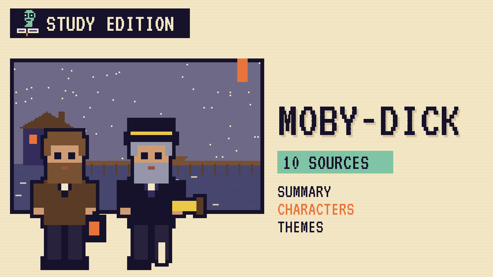

# Moby-Dick
### Unwritten Chapters Study Guide · E05 · "Ahab Turns for Home"

| | |
|---|---|
| **Author** | Herman Melville |
| **Published** | 1851 |
| **Setting** | Nantucket and the Atlantic, Indian and Pacific Oceans, 1840s |
| **Free text** | [Project Gutenberg](https://www.gutenberg.org/ebooks/2701) |
| **Study script** | [Read-aloud script](../scripts/E05-moby-dick-study-script.md) |
| **Video** | [Watch the 8.5-minute Study Edition](https://www.youtube.com/watch?v=YOUTUBE_ID_E05) · [captions](../captions/E05-moby-dick.srt) |

> Near the end of Moby-Dick, on a calm blue morning, Captain Ahab almost turns his ship for home. This guide covers the novel and a version where he does.

## The book in brief

A young sailor who asks us to call him Ishmael signs on to a whaling ship from Nantucket called the *Pequod*. Its captain, Ahab, has lost a leg to a giant white sperm whale called Moby Dick, and he's sworn to find it. He nails a gold coin to the mast for whoever sees the whale first.

The book follows the long voyage across the oceans, mixing adventure with chapters about whales, ships and the sea. Near the end, in a chapter called "The Symphony," Ahab talks gently with his first mate, Starbuck, about the wife and child he left at home. Starbuck begs him to turn back.

Ahab won't turn back. The *Pequod* finds the white whale, and after a three-day chase the ship is destroyed. Only Ishmael survives to tell the story.

## Read-along: how the book begins

[warmly, clearly]

Here's a short taste of the real thing. Listen to how the language sounds.

[Quote card shows the passage line by line.]

Call me Ishmael. Some years ago—never mind how long precisely—having little or no money in my purse, and nothing particular to interest me on shore, I thought I would sail about a little and see the watery part of the world. It is a way I have of driving off the spleen and regulating the circulation. Whenever I find myself growing grim about the mouth; whenever it is a damp, drizzly November in my soul; whenever I find myself involuntarily pausing before coffin warehouses, and bringing up the rear of every funeral I meet; and especially whenever my hypos get such an upper hand of me, that it requires a strong moral principle to prevent me from deliberately stepping into the street, and methodically knocking people’s hats off—then, I account it high time to get to sea as soon as I can. There is nothing surprising in this. If they but knew it, almost all men in their degree, some time or other, cherish very nearly the same feelings towards the ocean with me.

[brightly]

The words are old, but you can already hear the voice of the book.

[Beat. Music sting.]

## Who's who

- **Ishmael**: The narrator, a thoughtful young sailor who goes to sea when he feels gloomy.
- **Captain Ahab**: The *Pequod*'s captain, who has a whalebone leg and wants revenge on the white whale.
- **Starbuck**: The careful first mate from Nantucket, who has a wife and young son at home.
- **Queequeg**: A harpooneer from a South Sea island, and Ishmael's closest friend.
- **Moby Dick**: The great white whale, famous all over the ocean.

## Big ideas

- **Obsession.** Ahab can't let go of his anger at the whale. It pushes everything else out of his life.
- **Home.** Starbuck keeps thinking of his wife and son. The calm chapter "The Symphony" shows Ahab remembering home too.
- **Choice.** In the book, Ahab says he can't stop. A what-if asks what happens if he chooses differently.
- **The size of the sea.** Melville fills the book with facts about whales and oceans to show how huge and mysterious the natural world is.

## Key quotes

> "Call me Ishmael."  
> — *Moby-Dick*, 1851, chapter 1

*In plain words:* One of the most famous first lines in literature.

> "It was a clear steel-blue day."  
> — *Moby-Dick*, 1851, chapter 132

*In plain words:* The gentle opening of "The Symphony."

> "Away with me! let us fly these deadly waters! let us home!"  
> — *Moby-Dick*, 1851, chapter 132

*In plain words:* Starbuck begging Ahab to turn for home.

## Words to know

| Word | Meaning |
|---|---|
| masthead | the very top of a ship's mast, used as a lookout |
| harpoon | a spear used for hunting whales |
| doubloon | a Spanish gold coin |
| first mate | the officer second in command after the captain |
| quarter-deck | the raised deck at the back of a ship, where the captain stands |

## Our what-if: "Ahab Turns for Home"

In our story, everything happens as it does in the book until that calm blue morning in "The Symphony." Starbuck begs Ahab to turn for home, and this time Ahab doesn't look away. He calls the crew and orders the ship about.

Ahab gives the gold coin from the mast to Starbuck for his son, and the *Pequod* sails home the long way to Nantucket. The white whale swims on, free. Ishmael lives to write the story, beginning with the same three words.

## Discussion questions

1. Why do you think Melville includes so many chapters of facts about whales?
2. What does Starbuck want, and how is it different from what Ahab wants?
3. In "The Symphony," what makes Ahab almost change his mind?
4. Our story keeps everything the same until one moment. Why do small choices matter so much in stories?

## Activity

Write the log. Pretend you're Starbuck, and write one page of the ship's log for the day the *Pequod* turned for home, using only facts from the guide.

## 10 sources: museums, archives and primary sources

| # | Source | Type | Why it's useful |
|---|---|---|---|
| 1 | [New Bedford Whaling Museum](https://www.whalingmuseum.org/) | Museum | The world's largest museum of whaling history, near where Melville sailed. |
| 2 | [Mystic Seaport Museum](https://www.mysticseaport.org/) | Historic site | Home of the *Charles W. Morgan*, the last wooden whaleship. |
| 3 | [Nantucket Historical Association](https://nha.org/) | Museum | Nantucket's whaling museum and archives. |
| 4 | [Arrowhead, Melville's home](https://www.mobydick.org/) | Historic site | The farmhouse where Melville wrote *Moby-Dick*. |
| 5 | [Melville's Marginalia Online](https://melvillesmarginalia.org/) | Manuscript | The books Melville owned, with his own notes in the margins. |
| 6 | [Houghton Library, Harvard](https://library.harvard.edu/libraries/houghton) | Archive | Home of the Melville family papers. |
| 7 | [Berkshire Athenaeum](https://www.berkshireathenaeum.org/) | Archive | The library in Pittsfield with a room devoted to Melville. |
| 8 | [Power Moby-Dick](https://powermobydick.com/) | Archive | The full text with notes explaining hard words and references. |
| 9 | [The Moby-Dick Big Read](https://www.mobydickbigread.com/) | Audio | Every chapter read aloud by a different reader. |
| 10 | [*Moby-Dick* (free text)](https://www.gutenberg.org/ebooks/2701) | Free text | The full novel, free to read. |

---
*Part of the [Unwritten Chapters Study Guides](../README.md). Free for classroom use under CC BY 4.0.*
