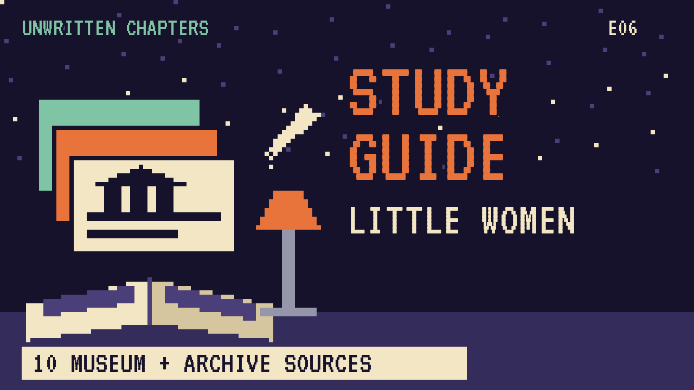

# Little Women
### Unwritten Chapters Study Guide · E06 · "Jo Says Yes"

| | |
|---|---|
| **Author** | Louisa May Alcott |
| **Published** | 1868 to 1869 |
| **Setting** | Concord, Massachusetts, and New York, 1860s |
| **Free text** | [Project Gutenberg](https://www.gutenberg.org/ebooks/514) |
| **Study script** | [Read-aloud script](../scripts/E06-little-women-study-script.md) |
| **Video** | [Watch the 8.5-minute Study Edition](https://www.youtube.com/watch?v=YOUTUBE_ID_E06) · [captions](../captions/E06-little-women.srt) |

> When Laurie asks Jo March to marry him, she says no, and readers have argued about it ever since. This guide covers the novel and a version where Jo says yes and keeps her freedom.

## The book in brief

The four March sisters, Meg, Jo, Beth and Amy, live with their mother, Marmee, while their father serves in the Civil War. They're poor, but their home is full of love, plays and writing. Next door lives Laurie, a lonely rich boy who becomes their best friend.

Jo wants to be a writer and hates the idea of giving up her freedom. As they grow up, Meg marries, Beth falls ill, and Jo goes to New York to work and write. There she meets Professor Bhaer.

When Laurie proposes, Jo tells him she can't love him that way. He later marries Amy, Beth dies, and Jo marries the professor. They open a school at Plumfield.

## Read-along: how the book begins

[warmly, clearly]

Here's a short taste of the real thing. Listen to how the language sounds.

[Quote card shows the passage line by line.]

New York, November

Dear Marmee and Beth,

I’m going to write you a regular volume, for I’ve got heaps to tell, though I’m not a fine young lady traveling on the continent. When I lost sight of Father’s dear old face, I felt a trifle blue, and might have shed a briny drop or two, if an Irish lady with four small children, all crying more or less, hadn’t diverted my mind, for I amused myself by dropping gingerbread nuts over the seat every time they opened their mouths to roar.

Soon the sun came out, and taking it as a good omen, I cleared up likewise and enjoyed my journey with all my heart.

[brightly]

The words are old, but you can already hear the voice of the book.

[Beat. Music sting.]

## Who's who

- **Jo March**: The second sister, a fierce, funny writer.
- **Theodore "Laurie" Laurence**: The boy next door. Jo calls him Teddy.
- **Meg, Beth and Amy**: Jo's sisters, who are kind, gentle and artistic.
- **Marmee**: The girls' wise mother.
- **Professor Bhaer**: A kind, shabby German teacher Jo meets in New York.

## Big ideas

- **Liberty.** Jo fears that marriage will take her freedom. The book and our story answer that fear differently.
- **Work and art.** Jo writes for money and for love, and must decide which stories are true to her.
- **Family.** The March home is poor but full of warmth.
- **Choices.** Our story suggests there are many good lives, and the right one is the one that's yours.

## Key quotes

> "I've loved you ever since I've known you, Jo; couldn't help it, you've been so good to me."  
> — *Little Women*, Part Second, "Heartache"

*In plain words:* Laurie's proposal by the river.

> "I don't believe I shall ever marry. I'm happy as I am, and love my liberty too well to be in a hurry to give it up for any mortal man."  
> — *Little Women*, Part Second

*In plain words:* Jo's view of marriage.

## Words to know

| Word | Meaning |
|---|---|
| garret | a small room at the top of a house, under the roof |
| liberty | freedom to live your own way |
| sensational | shocking, written to thrill |
| apprentice | someone learning a trade from a master |

## Our what-if: "Jo Says Yes"

In our story, Jo says yes under the willow by the river. Their marriage has quarrels, but they stay best friends.

Laurie protects her writing time, turns down his grandfather's business to study music, and tells her to write "the true one" instead of the thrilling stories editors want. Jo writes about four sisters, and it's a success. She learns that marriage doesn't have to cost her liberty.

## Discussion questions

1. Why does Jo say no to Laurie in the book? Do you agree with her reasons?
2. In our version, what does Laurie do that protects Jo's liberty?
3. Jo writes thrilling stories for money. Why does she stop?
4. Which March sister do you understand best, and why?

## Activity

Draw Jo's writing cap rules. Make a sign for the garret door that explains what each position of the cap means, using the details from the book.

## 10 sources: museums, archives and primary sources

| # | Source | Type | Why it's useful |
|---|---|---|---|
| 1 | [Louisa May Alcott's Orchard House](https://www.louisamayalcott.org/) | Historic site | The home where Alcott wrote *Little Women*. |
| 2 | [Orchard House "Digital Discoveries"](https://louisamayalcott.org/digital-discoveries) | Digital tour | Online programs and virtual looks inside the house. |
| 3 | [Houghton Library, Harvard](https://library.harvard.edu/libraries/houghton) | Archive | Home of the Alcott family papers and letters. |
| 4 | [Concord Museum](https://concordmuseum.org/) | Museum | Objects from the Concord of the Alcotts, Emerson and Thoreau. |
| 5 | [Fruitlands Museum](https://thetrustees.org/place/fruitlands-museum/) | Historic site | The farm where the Alcott family once tried an ideal community. |
| 6 | [Massachusetts Historical Society](https://www.masshist.org/) | Archive | Letters, diaries and photos of 19th-century Massachusetts. |
| 7 | [Library of Congress Civil War photographs](https://www.loc.gov/pictures/collection/cwp/) | Primary source | Images of the war Mr March went away to. |
| 8 | [1868 first edition scans](https://archive.org/search?query=little+women+1868) | First edition | The book as first printed, with May Alcott's drawings. |
| 9 | [LibriVox audiobook](https://librivox.org/search?q=little+women) | Audio | Free volunteer readings. |
| 10 | [*Little Women* (free text)](https://www.gutenberg.org/ebooks/514) | Free text | The complete novel, both parts. |

---
*Part of the [Unwritten Chapters Study Guides](../README.md). Free for classroom use under CC BY 4.0.*
