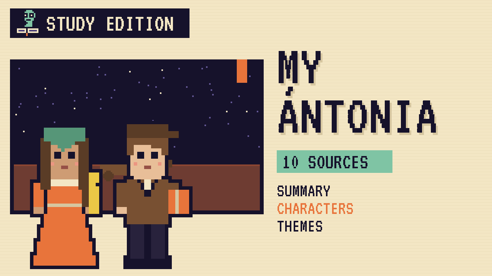

# My Ántonia
### Unwritten Chapters Study Guide · E07 · "Jim Stays on the Prairie"

| | |
|---|---|
| **Author** | Willa Cather |
| **Published** | 1918 |
| **Setting** | Nebraska prairie, 1880s to 1910s |
| **Free text** | [Project Gutenberg](https://www.gutenberg.org/ebooks/242) |
| **Study script** | [Read-aloud script](../scripts/E07-my-antonia-study-script.md) |
| **Video** | [Watch the 8.5-minute Study Edition](https://www.youtube.com/watch?v=YOUTUBE_ID_E07) · [captions](../captions/E07-my-antonia.srt) |

> Jim Burden grows up on the Nebraska prairie, leaves for the city and spends his life missing it. This guide covers the novel and a version where he stays.

## The book in brief

Ten-year-old Jim Burden, an orphan from Virginia, comes to live with his grandparents in Nebraska. On the same train is the Shimerda family, newly arrived from Bohemia, including a girl named Ántonia.

Jim teaches Ántonia English. Her family struggles through hard winters, and her father dies. As they grow up, Ántonia works in the fields and later as a hired girl in the town of Black Hawk.

Jim leaves for university and becomes a railroad lawyer in New York. Twenty years later he visits Ántonia, now married with many children on her own farm, and realises they share a past nobody else can understand.

## Read-along: how the book begins

[warmly, clearly]

Here's a short taste of the real thing. Listen to how the language sounds.

[Quote card shows the passage line by line.]

Last summer I happened to be crossing the plains of Iowa in a season of intense heat, and it was my good fortune to have for a traveling companion James Quayle Burden—Jim Burden, as we still call him in the West. He and I are old friends—we grew up together in the same Nebraska town—and we had much to say to each other. While the train flashed through never-ending miles of ripe wheat, by country towns and bright-flowered pastures and oak groves wilting in the sun, we sat in the observation car, where the woodwork was hot to the touch and red dust lay deep over everything. The dust and heat, the burning wind, reminded us of many things. We were talking about what it is like to spend one’s childhood in little towns like these, buried in wheat and corn, under stimulating extremes of climate: burning summers when the world lies green and billowy beneath a brilliant sky, when one is fairly stifled in vegetation, in the color and smell of strong weeds and heavy harvests; blustery winters with little snow, when the whole country is stripped bare and gray as sheet-iron. We agreed that no one who had not grown up in a little prairie town could know anything about it. It was a kind of freemasonry, we said.

[brightly]

The words are old, but you can already hear the voice of the book.

[Beat. Music sting.]

## Who's who

- **Jim Burden**: The narrator, a thoughtful boy who becomes a lawyer in the book.
- **Ántonia Shimerda**: A warm, strong girl from Bohemia.
- **Grandmother and Grandfather Burden**: Jim's kind, hardworking grandparents.
- **Anton Cuzak**: The cheerful Bohemian farmer Ántonia marries.

## Big ideas

- **Memory.** Most of the book is Jim remembering. A what-if asks what happens if he never has to.
- **Immigrant life.** Cather shows families from many countries building new lives on hard land.
- **Land and belonging.** The prairie shapes everyone who lives on it.
- **Ordinary heroism.** Ántonia's courage is in daily work, not big adventures.

## Key quotes

> "There seemed to be nothing to see; no fences, no creeks or trees, no hills or fields."  
> — *My Ántonia*, 1918, Book I, chapter 1

*In plain words:* Jim's first sight of the open prairie at night.

> "I was something that lay under the sun and felt it, like the pumpkins, and I did not want to be anything more. I was entirely happy."  
> — *My Ántonia*, 1918, Book I, chapter 2

*In plain words:* Jim's afternoon in his grandmother's garden.

> "Whatever we had missed, we possessed together the precious, the incommunicable past."  
> — *My Ántonia*, 1918, the last line

*In plain words:* They share a past no one else can understand.

## Words to know

| Word | Meaning |
|---|---|
| sod | blocks of earth and grass cut from the prairie, used for building |
| Bohemia | a region of central Europe, now part of the Czech Republic |
| homestead | land claimed by settlers under the 1862 Homestead Act |
| incommunicable | impossible to explain to anyone else |

## Our what-if: "Jim Stays on the Prairie"

In our story, Jim gives up his train ticket and stays. He becomes the teacher at the little sod schoolhouse, teaching immigrant children English the way he once taught Ántonia.

He's there when she marries Anton Cuzak and when their first son comes to school. He still sees the famous plough against the sunset, but he never has to remember the prairie, because he never leaves it.

## Discussion questions

1. How does the prairie make Jim feel on his first night? How does that change?
2. What hardships do the Shimerdas face that the Burdens don't?
3. In our version, what does Jim gain by staying? What might he lose?
4. Why is the plough against the sunset such a famous image?

## Activity

Build a sod house. Using details from the book and the Homestead National Historical Park site, sketch and label a sod house and list what a family would need to survive one winter in it.

## 10 sources: museums, archives and primary sources

| # | Source | Type | Why it's useful |
|---|---|---|---|
| 1 | [The Willa Cather Archive](https://cather.unl.edu/) | Archive | Cather's letters, writings and photos, free from the University of Nebraska. |
| 2 | [Willa Cather Foundation, Red Cloud](https://www.willacather.org/) | Historic site | Cather's childhood town, the model for Black Hawk. |
| 3 | [Homestead National Historical Park](https://www.nps.gov/home/) | Historic site | The National Park Service site about prairie homesteading. |
| 4 | [History Nebraska](https://history.nebraska.gov/) | Archive | Photos, maps and records of Nebraska settlers. |
| 5 | [Prairie Settlement: Nebraska Photographs and Family Letters](https://www.loc.gov/collections/prairie-settlement-nebraska-photographs-and-family-letters-1862-to-1912/) | Primary source | Solomon Butcher's sod-house photos and real settler letters at the Library of Congress. |
| 6 | [National Czech & Slovak Museum](https://ncsml.org/) | Museum | The story of Czech and Slovak immigrants like the Shimerdas. |
| 7 | [Chronicling America newspapers](https://chroniclingamerica.loc.gov/) | Newspapers | Nebraska newspapers from the 1880s. |
| 8 | [1918 first edition scans](https://archive.org/search?query=my+antonia+1918) | First edition | Includes W. T. Benda's original drawings. |
| 9 | [LibriVox audiobook](https://librivox.org/search?q=my+antonia) | Audio | Free volunteer readings. |
| 10 | [*My Ántonia* (free text)](https://www.gutenberg.org/ebooks/242) | Free text | The complete novel. |

---
*Part of the [Unwritten Chapters Study Guides](../README.md). Free for classroom use under CC BY 4.0.*
