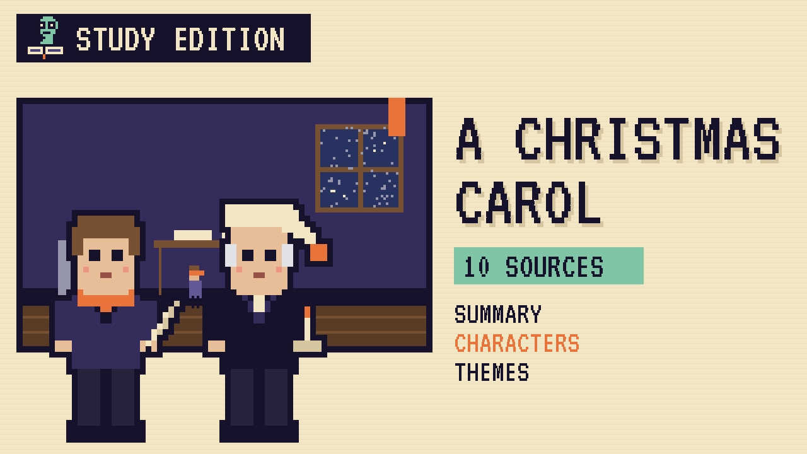

# A Christmas Carol
### Unwritten Chapters Study Guide · E08 · "Bob Stays Late"

| | |
|---|---|
| **Author** | Charles Dickens |
| **Published** | 1843 |
| **Setting** | London, Christmas Eve and Christmas Day |
| **Free text** | [Project Gutenberg](https://www.gutenberg.org/ebooks/46) |
| **Study script** | [Read-aloud script](../scripts/E08-a-christmas-carol-study-script.md) |
| **Video** | [Watch the 8.5-minute Study Edition](https://www.youtube.com/watch?v=YOUTUBE_ID_E08) · [captions](../captions/E08-a-christmas-carol.srt) |

> Before the ghosts change Scrooge, there's a freezing clerk with one coal on his fire. This guide covers the story and a version where a small kindness comes first.

## The book in brief

Ebenezer Scrooge is a mean, rich moneylender. On Christmas Eve he refuses to give to charity and barely lets his clerk, Bob Cratchit, have the day off.

That night the ghost of his old partner, Jacob Marley, warns him to change. Three spirits then visit. The Ghost of Christmas Past shows him his lonely childhood. The Ghost of Christmas Present shows him the poor but happy Cratchit family and their sick son, Tiny Tim. The Ghost of Christmas Yet to Come shows him his own lonely death.

Scrooge wakes on Christmas morning a changed man. He sends the Cratchits a huge turkey, raises Bob's salary, and becomes a second father to Tiny Tim.

## Read-along: how the book begins

[warmly, clearly]

Here's a short taste of the real thing. Listen to how the language sounds.

[Quote card shows the passage line by line.]

MARLEY was dead: to begin with. There is no doubt whatever about that. The register of his burial was signed by the clergyman, the clerk, the undertaker, and the chief mourner. Scrooge signed it: and Scrooge's name was good upon 'Change, for anything he chose to put his hand to. Old Marley was as dead as a door-nail.

Mind! I don't mean to say that I know, of my own knowledge, what there is particularly dead about a door-nail. I might have been inclined, myself, to regard a coffin-nail as the deadest piece of ironmongery in the trade. But the wisdom of our ancestors is in the simile; and my unhallowed hands shall not disturb it, or the Country's done for. You will therefore permit me to repeat, emphatically, that Marley was as dead as a door-nail.

Scrooge knew he was dead? Of course he did. How could it be otherwise? Scrooge and he were partners for I don't know how many years. Scrooge was his sole executor, his sole administrator, his sole assign, his sole residuary legatee, his sole friend, and sole mourner. And even Scrooge was not so dreadfully cut up by the sad event, but that he was an excellent man of business on the very day of the funeral, and solemnised it with an undoubted bargain.

[brightly]

The words are old, but you can already hear the voice of the book.

[Beat. Music sting.]

## Who's who

- **Ebenezer Scrooge**: A cold, greedy old man.
- **Bob Cratchit**: Scrooge's poor, patient clerk.
- **Tiny Tim**: Bob's youngest son, small and ill.
- **Jacob Marley**: Scrooge's dead partner, who returns as a ghost.
- **The three spirits**: Christmas Past, Present and Yet to Come.

## Big ideas

- **Change.** Dickens believed anyone could change, even Scrooge.
- **Poverty.** The Cratchits show how hard life was for working families in 1840s London.
- **Small kindnesses.** Dickens shows that big changes can start with small acts.
- **Generosity.** Scrooge's change is shown in what he gives.

## Key quotes

> "Bah! Humbug!"  
> — *A Christmas Carol*, 1843, Stave One

*In plain words:* Scrooge's famous dismissal of Christmas.

> "God bless us every one!"  
> — *A Christmas Carol*, 1843, Stave Three

*In plain words:* Tiny Tim's toast.

> "I will honour Christmas in my heart, and try to keep it all the year."  
> — *A Christmas Carol*, 1843, Stave Four

*In plain words:* Scrooge's promise to change.

## Words to know

| Word | Meaning |
|---|---|
| counting-house | an office where money and accounts are kept |
| comforter | a long woollen scarf |
| stave | a verse of a song. Dickens uses it for chapters |
| humbug | nonsense or a fraud |

## Our what-if: "Bob Stays Late"

In our story, Bob stays late to finish the books, and Scrooge comes back for his scarf. Without a kind word, Scrooge adds one coal to Bob's fire and hears about Tim for the first time.

So when the spirits come, the door is already open a little. Scrooge knows Tim's name before he's told it. The ghosts finish what a clerk and a coal began.

## Discussion questions

1. Why does Dickens call the chapters "staves"?
2. What does each of the three spirits show Scrooge, and why in that order?
3. In our version, why does knowing Tim's name make a difference?
4. Dickens wrote this book partly to make readers care about the poor. Does it still work today?

## Activity

Compare the manuscript. Look at a page of Dickens's handwritten manuscript at the Morgan Library site and list two changes he made while writing.

## 10 sources: museums, archives and primary sources

| # | Source | Type | Why it's useful |
|---|---|---|---|
| 1 | [The Morgan Library: Dickens's *A Christmas Carol*](https://www.themorgan.org/exhibitions/charles-dickenss-christmas-carol) | Manuscript | The original handwritten manuscript, shown every December. |
| 2 | [Charles Dickens Museum, London](https://dickensmuseum.com/) | Museum | Dickens's family home on Doughty Street. |
| 3 | [Dickens Journals Online](https://www.djo.org.uk/) | Primary source | Dickens's own magazines, free and searchable. |
| 4 | [Victoria and Albert Museum](https://www.vam.ac.uk/) | Museum | Holds many of Dickens's manuscripts and Victorian objects. |
| 5 | [London Museum](https://www.londonmuseum.org.uk/) | Museum | Everyday life in Victorian London. |
| 6 | [The Dickens Fellowship](https://www.dickensfellowship.org/) | Archive | Talks, articles and the journal *The Dickensian*. |
| 7 | [The Victorian Web](https://victorianweb.org/) | Archive | Essays and images on Dickens's world. |
| 8 | [1843 first edition with John Leech's pictures](https://archive.org/search?query=christmas+carol+1843) | First edition | The book as Dickens's first readers saw it. |
| 9 | [LibriVox audiobook](https://librivox.org/search?q=christmas+carol) | Audio | Free volunteer readings. |
| 10 | [*A Christmas Carol* (free text)](https://www.gutenberg.org/ebooks/46) | Free text | The complete story. |

---
*Part of the [Unwritten Chapters Study Guides](../README.md). Free for classroom use under CC BY 4.0.*
