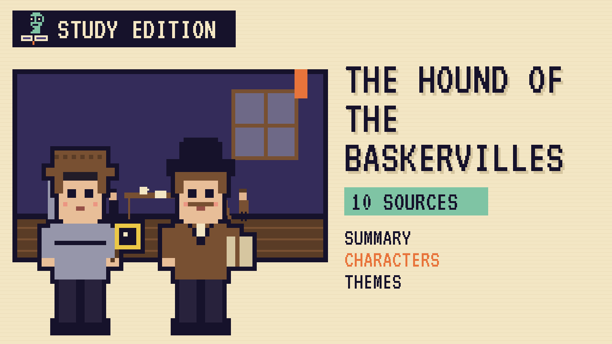

# The Hound of the Baskervilles
### Unwritten Chapters Study Guide · E09 · "The Hound on the Moor"

| | |
|---|---|
| **Author** | Arthur Conan Doyle |
| **Published** | 1902 |
| **Setting** | London and Dartmoor, Devon |
| **Free text** | [Project Gutenberg](https://www.gutenberg.org/ebooks/2852) |
| **Study script** | [Read-aloud script](../scripts/E09-hound-of-the-baskervilles-study-script.md) |
| **Video** | [Watch the 8.5-minute Study Edition](https://www.youtube.com/watch?v=YOUTUBE_ID_E09) · [captions](../captions/E09-hound-of-the-baskervilles.srt) |

> A legend says a giant hound hunts the Baskerville family. This guide covers the most famous Holmes novel and a version where the hound turns out to be a frightened, hungry dog.

## The book in brief

Dr Mortimer brings Holmes and Watson an old legend. A wicked Baskerville was once killed by a hellish hound, and the family has been cursed ever since. Sir Charles Baskerville has just died of fright, and giant paw prints were found near his body.

Watson goes to Dartmoor with the new heir, Sir Henry, while Holmes secretly watches from a stone hut. They meet the naturalist Stapleton and his sister, and the dangerous Grimpen Mire.

Holmes discovers that Stapleton is a hidden Baskerville heir who painted a huge dog with phosphorus to look like the legendary hound. On a foggy night the dog attacks Sir Henry, Holmes shoots it, and Stapleton vanishes into the mire.

## Read-along: how the book begins

[warmly, clearly]

Here's a short taste of the real thing. Listen to how the language sounds.

[Quote card shows the passage line by line.]

Mr. Sherlock Holmes, who was usually very late in the mornings, save upon those not infrequent occasions when he was up all night, was seated at the breakfast table. I stood upon the hearth-rug and picked up the stick which our visitor had left behind him the night before. It was a fine, thick piece of wood, bulbous-headed, of the sort which is known as a “Penang lawyer.” Just under the head was a broad silver band nearly an inch across. “To James Mortimer, M.R.C.S., from his friends of the C.C.H.,” was engraved upon it, with the date “1884.” It was just such a stick as the old-fashioned family practitioner used to carry—dignified, solid, and reassuring.

“Well, Watson, what do you make of it?”

Holmes was sitting with his back to me, and I had given him no sign of my occupation.

“How did you know what I was doing? I believe you have eyes in the back of your head.”

“I have, at least, a well-polished, silver-plated coffee-pot in front of me,” said he. “But, tell me, Watson, what do you make of our visitor’s stick? Since we have been so unfortunate as to miss him and have no notion of his errand, this accidental souvenir becomes of importance. Let me hear you reconstruct the man by an examination of it.”

“I think,” said I, following as far as I could the methods of my companion, “that Dr. Mortimer is a successful, elderly medical man, well-esteemed since those who know him give him this mark of their appreciation.”

[brightly]

The words are old, but you can already hear the voice of the book.

[Beat. Music sting.]

## Who's who

- **Sherlock Holmes**: The detective.
- **Dr Watson**: His friend and the narrator.
- **Dr James Mortimer**: The young country doctor who brings the case.
- **Sir Henry Baskerville**: The cheerful new heir, raised in Canada.
- **Jack Stapleton**: A quiet butterfly collector with a secret.

## Big ideas

- **Science against superstition.** Holmes proves there's a natural explanation behind the legend.
- **Noticing.** Holmes sees what others overlook.
- **Place.** Dartmoor's mist, mires and tors make the story feel dangerous.
- **Kindness.** In the book, the hound is half-starved, so the "monster" is a victim too.

## Key quotes

> "Mr. Holmes, they were the footprints of a gigantic hound!"  
> — *The Hound of the Baskervilles*, 1902, chapter 2

*In plain words:* Dr Mortimer's famous line.

> "The world is full of obvious things which nobody by any chance ever observes."  
> — *The Hound of the Baskervilles*, 1902, chapter 3

*In plain words:* Holmes on noticing what's in front of you.

## Words to know

| Word | Meaning |
|---|---|
| moor | wide, open, wild land, often boggy |
| tor | a pile of granite rock on a hilltop |
| mire | a deep, soft bog |
| phosphorus | a chemical that can glow in the dark |

## Our what-if: "The Hound on the Moor"

In our story, Holmes goes to the moor himself and walks out alone at dusk. He follows the wandering paw prints around the mire to an old tin mine, where the dog lies chained and starving.

He feeds it his sandwiches and wipes off the glowing paint. The police deal with the butterfly collector, and Sir Henry adopts the dog and names it Grimpen.

## Discussion questions

1. How does Holmes read the walking stick? What does that show about his method?
2. Why is Dartmoor such a good setting for this mystery?
3. In our version, what clue in the footprints tells Holmes the dog isn't hunting?
4. Who is the real villain of the story, the dog or the person who used it?

## Activity

Read a clue. Choose an everyday object at home and write what Holmes could work out about its owner, the way he does with Dr Mortimer's stick.

## 10 sources: museums, archives and primary sources

| # | Source | Type | Why it's useful |
|---|---|---|---|
| 1 | [Toronto Public Library, Arthur Conan Doyle Collection](https://digitalarchive.tpl.ca/people/40756/doyle-arthur-conan-18591930/objects) | Archive | Letters, first editions and Holmes materials online. |
| 2 | [*The Strand Magazine*, 1901 to 1902](https://archive.org/search?query=strand+magazine+1901) | First edition | Where the novel first appeared, with Sidney Paget's illustrations. |
| 3 | [Dartmoor National Park](https://www.dartmoor.gov.uk/) | Historic site | Maps, history and the real tors and mires. |
| 4 | [Museum of Dartmoor Life](https://museumofdartmoorlife.org.uk/) | Museum | How people lived and worked on the moor. |
| 5 | [Historic England](https://historicengland.org.uk/) | Archive | Search for Dartmoor's old tin mines and stone huts. |
| 6 | [Arthur Conan Doyle Encyclopedia](https://www.arthur-conan-doyle.com/) | Archive | Background on how Conan Doyle wrote the novel. |
| 7 | [Sherlock Holmes Museum](https://www.sherlock-holmes.co.uk/) | Museum | The Baker Street rooms recreated. |
| 8 | [The Baker Street Irregulars](https://bakerstreetirregulars.com/) | Archive | The oldest Holmes society, with articles and history. |
| 9 | [LibriVox audiobook](https://librivox.org/search?q=hound+of+the+baskervilles) | Audio | Free volunteer readings. |
| 10 | [*The Hound of the Baskervilles* (free text)](https://www.gutenberg.org/ebooks/2852) | Free text | The complete novel. |

---
*Part of the [Unwritten Chapters Study Guides](../README.md). Free for classroom use under CC BY 4.0.*
