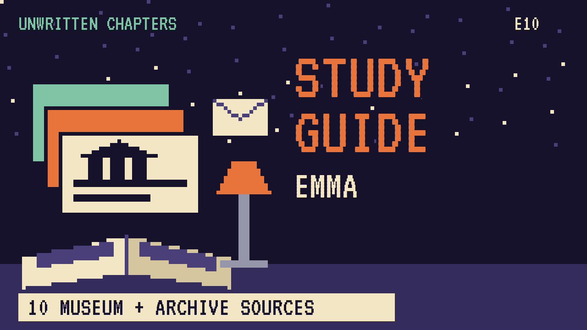

# Emma
### Unwritten Chapters Study Guide · E10 · "Emma Listens"

| | |
|---|---|
| **Author** | Jane Austen |
| **Published** | 1815 |
| **Setting** | Highbury, a village in Surrey, England |
| **Free text** | [Project Gutenberg](https://www.gutenberg.org/ebooks/158) |
| **Study script** | [Read-aloud script](../scripts/E10-emma-study-script.md) |

> Emma Woodhouse thinks she knows best about everyone's heart. This guide covers Austen's comedy and a version where Emma listens to Mr Knightley.

## The book in brief

Emma Woodhouse is clever, rich and sure she's a brilliant matchmaker. After her governess marries Mr Weston, Emma takes up a sweet, shy friend, Harriet Smith.

Harriet is loved by Robert Martin, a decent young farmer. Emma talks her out of his proposal, hoping she'll marry the vicar, Mr Elton. But Elton wants Emma, and Emma's schemes keep going wrong.

Her old friend Mr Knightley is the only person who tells her when she's wrong. After she's cruel to poor Miss Bates, his scolding helps her grow up. Harriet marries Robert Martin after all, and Emma realises she loves Mr Knightley.

## Read-along: how the book begins

[warmly, clearly]

Here's a short taste of the real thing. Listen to how the language sounds.

[Quote card shows the passage line by line.]

Emma Woodhouse, handsome, clever, and rich, with a comfortable home and happy disposition, seemed to unite some of the best blessings of existence; and had lived nearly twenty-one years in the world with very little to distress or vex her.

She was the youngest of the two daughters of a most affectionate, indulgent father; and had, in consequence of her sister’s marriage, been mistress of his house from a very early period. Her mother had died too long ago for her to have more than an indistinct remembrance of her caresses; and her place had been supplied by an excellent woman as governess, who had fallen little short of a mother in affection.

Sixteen years had Miss Taylor been in Mr. Woodhouse’s family, less as a governess than a friend, very fond of both daughters, but particularly of Emma. Between *them* it was more the intimacy of sisters. Even before Miss Taylor had ceased to hold the nominal office of governess, the mildness of her temper had hardly allowed her to impose any restraint; and the shadow of authority being now long passed away, they had been living together as friend and friend very mutually attached, and Emma doing just what she liked; highly esteeming Miss Taylor’s judgment, but directed chiefly by her own.

The real evils, indeed, of Emma’s situation were the power of having rather too much her own way, and a disposition to think a little too well of herself; these were the disadvantages which threatened alloy to her many enjoyments. The danger, however, was at present so unperceived, that they did not by any means rank as misfortunes with her.

[brightly]

The words are old, but you can already hear the voice of the book.

[Beat. Music sting.]

## Who's who

- **Emma Woodhouse**: Clever, confident and often wrong about other people.
- **Mr Knightley**: An honest family friend who isn't afraid to correct her.
- **Harriet Smith**: Emma's sweet, shy young friend.
- **Robert Martin**: A kind young farmer who loves Harriet.
- **Mr Woodhouse**: Emma's gentle, worried father.

## Big ideas

- **Listening.** Emma's big lesson is to listen instead of decide for people.
- **Class.** Emma looks down on farmers. The book shows that goodness matters more than rank.
- **Growing up.** Emma is nearly twenty-one but still has a lot to learn.
- **Honest friendship.** Mr Knightley shows that a true friend tells you the truth.

## Key quotes

> "Emma Woodhouse, handsome, clever, and rich, with a comfortable home and happy disposition, seemed to unite some of the best blessings of existence; and had lived nearly twenty-one years in the world with very little to distress or vex her."  
> — *Emma*, 1815, chapter 1

*In plain words:* Austen's opening line about Emma's lucky life.

> "If I loved you less, I might be able to talk about it more."  
> — *Emma*, 1815, chapter 49

*In plain words:* Mr Knightley's feelings are too big for clever speeches.

## Words to know

| Word | Meaning |
|---|---|
| parlour boarder | a pupil who lives with a teacher's family |
| tenant | someone who rents land or a house |
| gruel | a thin, warm porridge |
| disposition | a person's usual mood or nature |

## Our what-if: "Emma Listens"

In our story, Emma remembers Mr Knightley's words just as Harriet hands her the letter. For the first time, she asks Harriet what *she* wants.

Emma drives Harriet to Abbey-Mill Farm to give her answer in person, and leaves the young couple alone. That evening Mr Knightley tells Emma, "That was well done."

## Discussion questions

1. Why does Emma think Robert Martin isn't good enough for Harriet?
2. What makes Mr Knightley different from everyone else in Highbury?
3. In our version, what single question changes the story?
4. Is Emma a likeable heroine? Austen said she'd made a heroine "whom no one but myself will much like." Do you agree?

## Activity

Write Robert Martin's proposal. Using what the novel says about his letter, write a short, plain, honest proposal in his voice.

## 10 sources: museums, archives and primary sources

| # | Source | Type | Why it's useful |
|---|---|---|---|
| 1 | [Jane Austen's Fiction Manuscripts Digital Edition](https://janeausten.ac.uk/) | Manuscript | Austen's own handwriting, page by page. |
| 2 | [Jane Austen's House, Chawton](https://janeaustens.house/) | Museum | The cottage where she wrote *Emma*. |
| 3 | [Chawton House](https://chawtonhouse.org/) | Historic site | A real English country estate of Austen's time. |
| 4 | [Box Hill (National Trust)](https://www.nationaltrust.org.uk/visit/surrey/box-hill) | Historic site | The setting of the picnic where Emma is cruel to Miss Bates. |
| 5 | [Jane Austen Society of North America](https://jasna.org/) | Archive | Essays and *Persuasions On-Line*. |
| 6 | [The Met Collection: Regency fashion](https://www.metmuseum.org/art/collection) | Museum | Real dresses and bonnets from 1815. |
| 7 | [Jane Austen Centre, Bath](https://janeausten.co.uk/) | Museum | Regency daily life. |
| 8 | [1815 first edition scans](https://archive.org/search?query=emma+austen+1816) | First edition | The first printing, dated 1816 on its title page. |
| 9 | [LibriVox audiobook](https://librivox.org/search?q=emma+austen) | Audio | Free volunteer readings. |
| 10 | [*Emma* (free text)](https://www.gutenberg.org/ebooks/158) | Free text | The complete novel. |

---
*Part of the [Unwritten Chapters Study Guides](../README.md). Free for classroom use under CC BY 4.0.*
