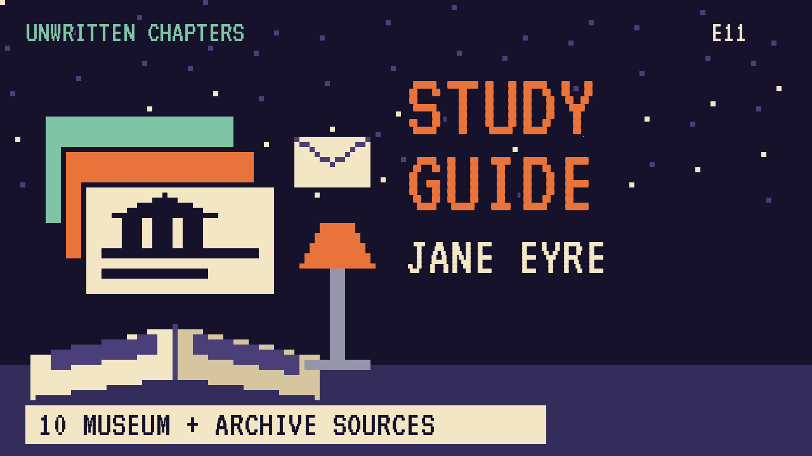

# Jane Eyre
### Unwritten Chapters Study Guide · E11 · "Helen Stays"

| | |
|---|---|
| **Author** | Charlotte Brontë |
| **Published** | 1847 |
| **Setting** | Lowood School, northern England, early 1800s |
| **Free text** | [Project Gutenberg](https://www.gutenberg.org/ebooks/1260) |
| **Study script** | [Read-aloud script](../scripts/E11-jane-eyre-study-script.md) |

> At a cold charity school, young Jane Eyre finds her first true friend, Helen Burns, and then loses her. This guide covers the novel and a version where Helen gets well.

## The book in brief

Jane Eyre is an orphan raised by a cruel aunt. At ten she's sent to Lowood, a harsh charity school run by Mr Brocklehurst. There she meets the kind teacher Miss Temple and a patient older girl, Helen Burns, who becomes her best friend. Helen dies of illness during a fever outbreak.

After eight years at Lowood, Jane becomes a governess at Thornfield Hall and falls in love with its owner, Mr Rochester. On their wedding day she learns he's already married to a woman hidden in the attic, and she leaves.

Years later, now independent, Jane returns to find Thornfield burned and Rochester blinded. They marry, as equals.

## Read-along: how the book begins

[warmly, clearly]

Here's a short taste of the real thing. Listen to how the language sounds.

[Quote card shows the passage line by line.]

Five o’clock had hardly struck on the morning of the 19th of January, when Bessie brought a candle into my closet and found me already up and nearly dressed. I had risen half-an-hour before her entrance, and had washed my face, and put on my clothes by the light of a half-moon just setting, whose rays streamed through the narrow window near my crib. I was to leave Gateshead that day by a coach which passed the lodge gates at six A.M. Bessie was the only person yet risen; she had lit a fire in the nursery, where she now proceeded to make my breakfast. Few children can eat when excited with the thoughts of a journey; nor could I. Bessie, having pressed me in vain to take a few spoonfuls of the boiled milk and bread she had prepared for me, wrapped up some biscuits in a paper and put them into my bag; then she helped me on with my pelisse and bonnet, and wrapping herself in a shawl, she and I left the nursery. As we passed Mrs. Reed’s bedroom, she said, “Will you go in and bid Missis good-bye?”

“No, Bessie: she came to my crib last night when you were gone down to supper, and said I need not disturb her in the morning, or my cousins either; and she told me to remember that she had always been my best friend, and to speak of her and be grateful to her accordingly.”

“What did you say, Miss?”

“Nothing: I covered my face with the bedclothes, and turned from her to the wall.”

[brightly]

The words are old, but you can already hear the voice of the book.

[Beat. Music sting.]

## Who's who

- **Jane Eyre**: A plain, proud, honest orphan.
- **Helen Burns**: Jane's gentle friend, who believes in forgiveness.
- **Miss Temple**: The kind superintendent of Lowood.
- **Mr Brocklehurst**: The harsh man who runs the school.
- **Mr Rochester**: The moody master of Thornfield Hall.

## Big ideas

- **Independence.** Jane insists on being treated as a free, equal person.
- **Forgiveness.** Helen teaches Jane that life is too short for grudges.
- **Cruelty and kindness.** Lowood shows both, Brocklehurst's coldness and Miss Temple's care.
- **Friendship.** Our story imagines what a lifelong friend could have meant to Jane.

## Key quotes

> "Life appears to me too short to be spent in nursing animosity or registering wrongs."  
> — *Jane Eyre*, 1847, chapter 6

*In plain words:* Helen's belief that life's too short to hold grudges.

> "I am no bird; and no net ensnares me: I am a free human being with an independent will."  
> — *Jane Eyre*, 1847, chapter 23

*In plain words:* Jane's declaration of freedom.

## Words to know

| Word | Meaning |
|---|---|
| governess | a woman who teaches children in their family's home |
| superintendent | the person in charge of a school |
| animosity | strong dislike |
| beck | a northern English word for a stream |

## Our what-if: "Helen Stays"

In our story, Miss Temple notices Helen's cough and sends her to her sister's cottage by the sea. Helen writes to Jane every Saturday and comes back in September, strong and brown from the sun.

The two girls grow up together and become teachers at the improved school. When Jane leaves for Thornfield, it's Helen who tells her to go, and her letters keep coming wherever Jane is.

## Discussion questions

1. How does Helen's way of handling unfairness differ from Jane's?
2. What does Miss Temple do that shows she cares about the girls?
3. In our version, what changes at Lowood, and who makes it happen?
4. Why does "I am no bird" still matter to readers today?

## Activity

Write Helen's first letter. Using details from the guide, write Helen's first Saturday letter from the cottage by the sea.

## 10 sources: museums, archives and primary sources

| # | Source | Type | Why it's useful |
|---|---|---|---|
| 1 | [Brontë Parsonage Museum](https://www.bronte.org.uk/) | Museum | The Haworth home where Charlotte wrote *Jane Eyre*. |
| 2 | [The Morgan Library & Museum](https://www.themorgan.org/) | Manuscript | Holds Brontë manuscripts, letters and juvenilia. |
| 3 | [Houghton Library, Harvard](https://library.harvard.edu/libraries/houghton) | Archive | Holds the Brontë children's tiny handmade books. |
| 4 | [Historic England](https://historicengland.org.uk/) | Archive | Search for Cowan Bridge, the school that inspired Lowood. |
| 5 | [The Victorian Web: the Brontës](https://victorianweb.org/authors/bronte/) | Archive | Essays and images on the Brontë family. |
| 6 | [National Trust: Brontë Country houses](https://www.nationaltrust.org.uk/) | Historic site | Search "Brontë" for houses linked to the novels. |
| 7 | [1847 first edition scans](https://archive.org/search?query=jane+eyre+1847) | First edition | Published under the name "Currer Bell." |
| 8 | [Chronicling America newspapers](https://chroniclingamerica.loc.gov/) | Newspapers | Search "Jane Eyre" for early reviews in US papers. |
| 9 | [LibriVox audiobook](https://librivox.org/search?q=jane+eyre) | Audio | Free volunteer readings. |
| 10 | [*Jane Eyre* (free text)](https://www.gutenberg.org/ebooks/1260) | Free text | The complete novel. |

---
*Part of the [Unwritten Chapters Study Guides](../README.md). Free for classroom use under CC BY 4.0.*
