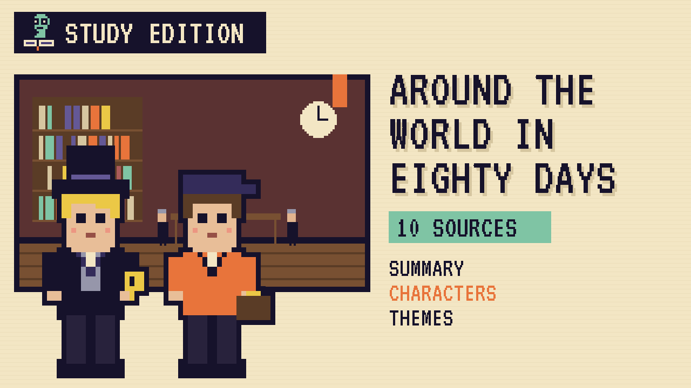

# Around the World in Eighty Days
### Unwritten Chapters Study Guide · E12 · "The Eighty-First Day"

| | |
|---|---|
| **Author** | Jules Verne |
| **Published** | 1872 |
| **Setting** | London and around the world, October to December 1872 |
| **Free text** | [Project Gutenberg](https://www.gutenberg.org/ebooks/103) |
| **Study script** | [Read-aloud script](../scripts/E12-around-the-world-in-80-days-study-script.md) |
| **Video** | [Watch the 8.5-minute Study Edition](https://www.youtube.com/watch?v=YOUTUBE_ID_E12) · [captions](../captions/E12-around-the-world-in-80-days.srt) |

> Phileas Fogg bets his fortune he can circle the globe in eighty days. This guide covers the novel and a version where, with forty minutes left, he chooses to be late.

## The book in brief

Phileas Fogg is an exact, wealthy London gentleman. At the Reform Club he bets twenty thousand pounds that he can travel round the world in eighty days. He leaves that night with his new French servant, Passepartout.

A detective named Fix, who thinks Fogg robbed the Bank of England, follows them. In India, Fogg rescues a young woman named Aouda. They cross the world by steamship, train, elephant and sledge, and when the coal runs out on the Atlantic, Fogg burns his ship's wooden parts.

Fix arrests Fogg in Liverpool, and he reaches London five minutes late. Ruined, he and Aouda agree to marry. Then Passepartout discovers they gained a day by travelling east, and Fogg races to the club and wins.

## Read-along: how the book begins

[warmly, clearly]

Here's a short taste of the real thing. Listen to how the language sounds.

[Quote card shows the passage line by line.]

IN WHICH PHILEAS FOGG AND PASSEPARTOUT ACCEPT EACH OTHER, THE ONE AS MASTER, THE OTHER AS MAN

Mr. Phileas Fogg lived, in 1872, at No. 7, Saville Row, Burlington Gardens, the house in which Sheridan died in 1814. He was one of the most noticeable members of the Reform Club, though he seemed always to avoid attracting attention; an enigmatical personage, about whom little was known, except that he was a polished man of the world. People said that he resembled Byron—at least that his head was Byronic; but he was a bearded, tranquil Byron, who might live on a thousand years without growing old.

[brightly]

The words are old, but you can already hear the voice of the book.

[Beat. Music sting.]

## Who's who

- **Phileas Fogg**: A precise, calm, very private Englishman.
- **Passepartout**: His cheerful French servant, a former acrobat and fireman.
- **Aouda**: A brave, educated young woman Fogg rescues in India.
- **Detective Fix**: A policeman who wrongly suspects Fogg of robbery.

## Big ideas

- **Time.** Fogg measures every minute, until he decides some things matter more.
- **Technology.** Verne celebrates the new railways and steamships that shrank the world.
- **Character beneath the surface.** Aouda sees Fogg's kindness under his calm.
- **What's worth winning.** Verne asks whether the trip was worth it. His answer is Aouda.

## Key quotes

> "I will bet twenty thousand pounds against anyone who wishes, that I will make the tour of the world in eighty days or less."  
> — *Around the World in Eighty Days*, 1872, chapter 3 (Towle translation)

*In plain words:* The famous wager.

> "Truly, would you not for less than that make the tour around the world?"  
> — *Around the World in Eighty Days*, 1872, chapter 37 (Towle translation)

*In plain words:* Verne's closing question to the reader.

## Words to know

| Word | Meaning |
|---|---|
| wager | a bet |
| punctual | always on time |
| Suez Canal | a waterway through Egypt, opened in 1869 |
| International Date Line | the line where travellers gain or lose a day |

## Our what-if: "The Eighty-First Day"

In our story, Fogg learns he has forty minutes left, then closes his watch, turns it to the wall, and asks for tea.

He loses the bet on purpose, marries Aouda, takes a job keeping accounts, and for the first time in his life begins to be late for things.

## Discussion questions

1. How did travelling east give Fogg an extra day?
2. Why does Aouda see Fogg differently from everyone in London?
3. In our version, why does Fogg choose not to race to the club?
4. What real inventions of the 1860s made the trip possible?

## Activity

Plot the route. On a world map, mark each stop of Fogg's trip and the transport he used between them, from London to London.

## 10 sources: museums, archives and primary sources

| # | Source | Type | Why it's useful |
|---|---|---|---|
| 1 | [Gallica, National Library of France](https://gallica.bnf.fr/) | First edition | Search "Le Tour du monde en quatre-vingts jours" for Verne's original illustrated editions. |
| 2 | [North American Jules Verne Society](https://najvs.org/) | Archive | Scholarship, translations and news about Verne. |
| 3 | [Nellie Bly, *Around the World in Seventy-Two Days*](https://archive.org/search?query=around+the+world+in+seventy-two+days+bly) | Primary source | The real reporter who beat Fogg's record in 1889 and 1890. |
| 4 | [Library of Congress guide to Nellie Bly](https://webarchive.library.unt.edu/web/20130110014233/http://www.loc.gov/rr/program/bib/bly) | Archive | Primary sources on Bly's race (archived copy). |
| 5 | [Chronicling America newspapers](https://chroniclingamerica.loc.gov/) | Newspapers | Search "Nellie Bly" in 1889 to 1890 papers. |
| 6 | [The Reform Club, London](https://www.reformclub.com/) | Historic site | The real club where Fogg makes his bet. |
| 7 | [National Railway Museum](https://www.railwaymuseum.org.uk/) | Museum | The trains and railways of Fogg's era. |
| 8 | [Library of Congress Prints and Photographs](https://www.loc.gov/pictures/) | Primary source | Search "Suez Canal 1870" for photos of the route. |
| 9 | [LibriVox audiobook](https://librivox.org/search?q=around+the+world+in+80+days) | Audio | Free volunteer readings. |
| 10 | [*Around the World in Eighty Days* (free text)](https://www.gutenberg.org/ebooks/103) | Free text | The complete novel in English. |

---
*Part of the [Unwritten Chapters Study Guides](../README.md). Free for classroom use under CC BY 4.0.*
