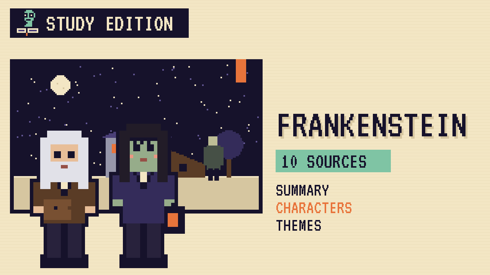

# Frankenstein
### Unwritten Chapters Study Guide · E13 · "The Cottage Door"

| | |
|---|---|
| **Author** | Mary Shelley |
| **Published** | 1818 |
| **Setting** | Geneva, the German forests and the Arctic, 1790s |
| **Free text** | [Project Gutenberg](https://www.gutenberg.org/ebooks/84) |
| **Study script** | [Read-aloud script](../scripts/E13-frankenstein-study-script.md) |
| **Video** | [Watch the 8.5-minute Study Edition](https://www.youtube.com/watch?v=YOUTUBE_ID_E13) · [captions](../captions/E13-frankenstein.srt) |

> Frankenstein's creature spends a winter secretly helping a poor family. This guide covers the novel and a version where they let him in.

## The book in brief

Victor Frankenstein, a young scientist, builds a creature from old parts and brings it to life. Horrified by how it looks, he runs away.

The creature, alone and rejected, hides beside the cottage of the De Lacey family. By listening through the wall he learns to speak and read, and he secretly cuts their firewood. When he finally meets the blind father, the son returns and drives him out.

Bitter and lonely, the creature takes revenge on Victor's family and asks Victor to make him a companion. Victor refuses, and the two chase each other to the Arctic, where the story is told to a ship's captain.

## Read-along: how the book begins

[warmly, clearly]

Here's a short taste of the real thing. Listen to how the language sounds.

[Quote card shows the passage line by line.]

“It is with considerable difficulty that I remember the original era of my being; all the events of that period appear confused and indistinct. A strange multiplicity of sensations seized me, and I saw, felt, heard, and smelt at the same time; and it was, indeed, a long time before I learned to distinguish between the operations of my various senses. By degrees, I remember, a stronger light pressed upon my nerves, so that I was obliged to shut my eyes. Darkness then came over me and troubled me, but hardly had I felt this when, by opening my eyes, as I now suppose, the light poured in upon me again. I walked and, I believe, descended, but I presently found a great alteration in my sensations. Before, dark and opaque bodies had surrounded me, impervious to my touch or sight; but I now found that I could wander on at liberty, with no obstacles which I could not either surmount or avoid. The light became more and more oppressive to me, and the heat wearying me as I walked, I sought a place where I could receive shade. This was the forest near Ingolstadt; and here I lay by the side of a brook resting from my fatigue, until I felt tormented by hunger and thirst. This roused me from my nearly dormant state, and I ate some berries which I found hanging on the trees or lying on the ground. I slaked my thirst at the brook, and then lying down, was overcome by sleep.

[brightly]

The words are old, but you can already hear the voice of the book.

[Beat. Music sting.]

## Who's who

- **Victor Frankenstein**: The scientist who creates life and abandons it.
- **The creature**: Gentle at first, made bitter by loneliness.
- **De Lacey**: The blind old father in the cottage.
- **Felix and Agatha**: His son and daughter.
- **Safie**: Felix's love, who comes from a far-off country.

## Big ideas

- **Responsibility.** Victor creates a life, then refuses to care for it.
- **Loneliness.** The creature's cruelty grows out of rejection.
- **Judging by appearance.** Only the blind man can hear who the creature really is.
- **Learning.** The creature learns language, books and kindness by watching others.

## Key quotes

> "I was benevolent and good; misery made me a fiend."  
> — *Frankenstein*, 1818, chapter 10

*In plain words:* He started out good. Loneliness made him a monster.

> "I am blind and cannot judge of your countenance, but there is something in your words which persuades me that you are sincere."  
> — *Frankenstein*, 1818, chapter 15

*In plain words:* De Lacey hears the creature's honesty.

## Words to know

| Word | Meaning |
|---|---|
| hovel | a small, rough shed |
| benevolent | kind and well-meaning |
| fiend | an evil, cruel being |
| countenance | a face |

## Our what-if: "The Cottage Door"

In our story, the blind old man stands between his son and the creature and says, "This is our friend." Agatha realises who's been cutting their wood all winter.

The family invites him to supper. He learns to play the guitar, helps on the farm, and is given a name, Bon. He never goes looking for Victor, and hopes someone has opened a door for him too.

## Discussion questions

1. Who is the real monster in *Frankenstein*? Give reasons.
2. How does the creature learn to speak and read?
3. Why is it important that De Lacey is blind?
4. In our version, what does Agatha notice that changes everything?

## Activity

See the manuscript. Find a page of Mary Shelley's handwritten draft on the Shelley-Godwin Archive and note one change made by her or by Percy Shelley.

## 10 sources: museums, archives and primary sources

| # | Source | Type | Why it's useful |
|---|---|---|---|
| 1 | [Shelley-Godwin Archive: the Frankenstein notebooks](https://shelleygodwinarchive.org/) | Manuscript | Mary Shelley's handwritten drafts, page by page. |
| 2 | [Bodleian Libraries, Oxford](https://www.bodleian.ox.ac.uk/) | Archive | Owner of the original Frankenstein manuscripts. |
| 3 | [Frankenstein Bicentennial Project, Arizona State](https://frankenstein.asu.edu/) | Digital tour | Free activities and essays on science, ethics and the novel. |
| 4 | [Keats-Shelley House, Rome](https://ksh.roma.it/) | Museum | A museum of the Romantic poets, including Percy and Mary Shelley. |
| 5 | [Romantic Circles](https://romantic-circles.org/) | Archive | Free scholarly editions and essays on the Romantic era. |
| 6 | [The Morgan Library & Museum](https://www.themorgan.org/) | Museum | Hosted the major exhibition "It's Alive! Frankenstein at 200." |
| 7 | [New York Public Library](https://www.nypl.org/) | Archive | Home of the Shelley and his Circle collection. |
| 8 | [1818 first edition scans](https://archive.org/search?query=frankenstein+1818) | First edition | The anonymous first edition in three volumes. |
| 9 | [LibriVox audiobook](https://librivox.org/search?q=frankenstein) | Audio | Free volunteer readings. |
| 10 | [*Frankenstein* (free text)](https://www.gutenberg.org/ebooks/84) | Free text | The complete 1818 text. |

---
*Part of the [Unwritten Chapters Study Guides](../README.md). Free for classroom use under CC BY 4.0.*
