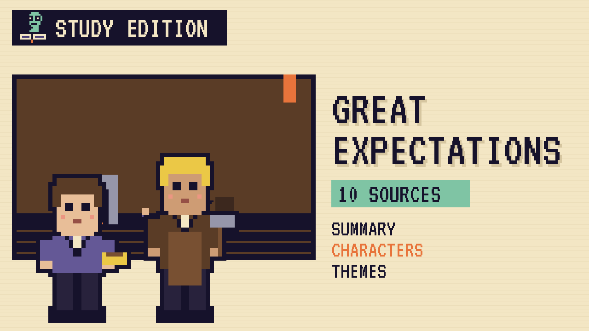

# Great Expectations
### Unwritten Chapters Study Guide · E14 · "Pip Stays at the Forge"

| | |
|---|---|
| **Author** | Charles Dickens |
| **Published** | 1861 |
| **Setting** | The Kent marshes and London, early 1800s |
| **Free text** | [Project Gutenberg](https://www.gutenberg.org/ebooks/1400) |
| **Study script** | [Read-aloud script](../scripts/E14-great-expectations-study-script.md) |
| **Video** | [Watch the 8.5-minute Study Edition](https://www.youtube.com/watch?v=YOUTUBE_ID_E14) · [captions](../captions/E14-great-expectations.srt) |

> A lawyer tells Pip that a secret stranger wants to make him a gentleman. This guide covers the novel and a version where Pip stays with Joe at the forge.

## The book in brief

Pip, an orphan, is raised by his harsh sister and her gentle husband, Joe Gargery, the village blacksmith. On the marshes one Christmas Eve he's forced to help an escaped convict.

He's sent to play at Satis House, where Miss Havisham sits in her old wedding dress with all the clocks stopped. Her proud ward, Estella, makes Pip ashamed of his coarse hands and his home.

A lawyer, Mr Jaggers, announces that Pip has "great expectations" from a secret helper. Pip becomes a gentleman in London and neglects Joe. He learns that his helper is the convict, Magwitch, not Miss Havisham. He loses his fortune, and Joe nurses him back to health.

## Read-along: how the book begins

[warmly, clearly]

Here's a short taste of the real thing. Listen to how the language sounds.

[Quote card shows the passage line by line.]

Mr. Pumblechook’s premises in the High Street of the market town, were of a peppercorny and farinaceous character, as the premises of a cornchandler and seedsman should be. It appeared to me that he must be a very happy man indeed, to have so many little drawers in his shop; and I wondered when I peeped into one or two on the lower tiers, and saw the tied-up brown paper packets inside, whether the flower-seeds and bulbs ever wanted of a fine day to break out of those jails, and bloom.

[brightly]

The words are old, but you can already hear the voice of the book.

[Beat. Music sting.]

## Who's who

- **Pip**: An orphan who dreams of being a gentleman.
- **Joe Gargery**: The gentle, loyal blacksmith who raises him.
- **Miss Havisham**: A rich, bitter woman frozen on her wedding day.
- **Estella**: Her proud, beautiful ward.
- **Biddy**: A clever, kind village girl.
- **Mr Jaggers**: A powerful London lawyer.

## Big ideas

- **Shame and home.** Pip learns to be ashamed of the people who love him.
- **Social class.** Dickens asks what really makes a "gentleman."
- **Loyalty.** Joe never stops loving Pip.
- **Choosing your life.** Pip has to learn which life is really his.

## Key quotes

> "It is a most miserable thing to feel ashamed of home."  
> — *Great Expectations*, 1861, chapter 14

*In plain words:* There's no worse feeling than being ashamed of where you come from.

> "Life is made of ever so many partings welded together."  
> — *Great Expectations*, 1861, chapter 27

*In plain words:* Joe describes life the way a blacksmith joins iron.

## Words to know

| Word | Meaning |
|---|---|
| forge | a blacksmith's workshop |
| apprentice | a young worker learning a trade |
| expectations | money and a future someone expects to inherit |
| bellows | a device that blows air to make a fire hotter |

## Our what-if: "Pip Stays at the Forge"

In our story, Pip sits alone on the forge step the night after Jaggers's news and looks at his own rough hands. He isn't ashamed of them anymore.

He turns the offer down. Joe paints a new sign, GARGERY & PIP, BLACKSMITHS. Pip marries Biddy, and their son learns the trade while teaching Joe the rest of the alphabet.

## Discussion questions

1. Why does Pip become ashamed of Joe?
2. What do the stopped clocks at Satis House show about Miss Havisham?
3. In our version, what makes Pip decide to stay?
4. What does Dickens think makes a real gentleman?

## Activity

Design the sign. Draw the GARGERY & PIP sign and write a short advertisement Joe might put in the village inn.

## 10 sources: museums, archives and primary sources

| # | Source | Type | Why it's useful |
|---|---|---|---|
| 1 | [Charles Dickens Museum, London](https://dickensmuseum.com/) | Museum | Dickens's home and many of his belongings. |
| 2 | [Wisbech & Fenland Museum](https://www.wisbechmuseum.org.uk/) | Manuscript | Holds Dickens's handwritten manuscript of *Great Expectations*. |
| 3 | [Dickens Journals Online](https://www.djo.org.uk/) | Primary source | *All the Year Round*, where the novel was first serialised in 1860 to 1861. |
| 4 | [Victoria and Albert Museum](https://www.vam.ac.uk/) | Museum | Victorian life and Dickens collections. |
| 5 | [The Dickens Fellowship](https://www.dickensfellowship.org/) | Archive | Articles and the journal *The Dickensian*. |
| 6 | [The Victorian Web](https://victorianweb.org/) | Archive | Essays on Dickens and Victorian society. |
| 7 | [Historic England](https://historicengland.org.uk/) | Archive | Search for Cooling church and the Kent marshes Dickens knew. |
| 8 | [1861 first edition scans](https://archive.org/search?query=great+expectations+1861) | First edition | The first three-volume printing. |
| 9 | [LibriVox audiobook](https://librivox.org/search?q=great+expectations) | Audio | Free volunteer readings. |
| 10 | [*Great Expectations* (free text)](https://www.gutenberg.org/ebooks/1400) | Free text | The complete novel. |

---
*Part of the [Unwritten Chapters Study Guides](../README.md). Free for classroom use under CC BY 4.0.*
