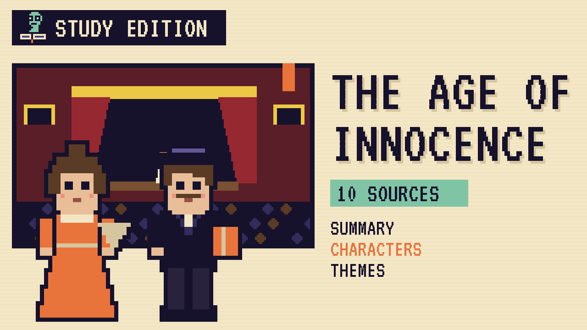

# The Age of Innocence
### Unwritten Chapters Study Guide · E15 · "Newland Goes Up"

| | |
|---|---|
| **Author** | Edith Wharton |
| **Published** | 1920 |
| **Setting** | New York in the 1870s, and Paris about thirty years later |
| **Free text** | [Project Gutenberg](https://www.gutenberg.org/ebooks/541) |
| **Study script** | [Read-aloud script](../scripts/E15-the-age-of-innocence-study-script.md) |
| **Video** | [Watch the 8.5-minute Study Edition](https://www.youtube.com/watch?v=YOUTUBE_ID_E15) · [captions](../captions/E15-the-age-of-innocence.srt) |

> Thirty years after he last saw her, Newland Archer sits below Ellen Olenska's window in Paris and decides not to go up. This guide covers the Pulitzer-winning novel and a version where he does.

## The book in brief

Newland Archer, a young lawyer from old New York society, is engaged to the lovely, proper May Welland. Then he meets May's cousin, Countess Ellen Olenska, who has left her cruel husband in Europe and come home.

Ellen is honest and unconventional, and Newland falls in love with her. He asks her to run away with him, but she refuses, because it would hurt May. Newland marries May, and Ellen returns to Paris.

Decades pass. After May's death, Newland's son Dallas takes him to Paris and tells him May always knew he'd given up the thing he wanted most. Outside Ellen's apartment, Newland sits on a bench, decides not to go up, and walks away.

## Read-along: how the book begins

[warmly, clearly]

Here's a short taste of the real thing. Listen to how the language sounds.

[Quote card shows the passage line by line.]

On a January evening of the early seventies, Christine Nilsson was singing in Faust at the Academy of Music in New York.

Though there was already talk of the erection, in remote metropolitan distances "above the Forties," of a new Opera House which should compete in costliness and splendour with those of the great European capitals, the world of fashion was still content to reassemble every winter in the shabby red and gold boxes of the sociable old Academy. Conservatives cherished it for being small and inconvenient, and thus keeping out the "new people" whom New York was beginning to dread and yet be drawn to; and the sentimental clung to it for its historic associations, and the musical for its excellent acoustics, always so problematic a quality in halls built for the hearing of music.

[brightly]

The words are old, but you can already hear the voice of the book.

[Beat. Music sting.]

## Who's who

- **Newland Archer**: A thoughtful young lawyer bound by society's rules.
- **May Welland**: His sweet, proper fiancée, later his wife.
- **Countess Ellen Olenska**: May's cousin, honest and independent.
- **Dallas Archer**: Newland's modern, cheerful eldest son.

## Big ideas

- **Duty and desire.** Newland must choose between what he wants and what's expected.
- **Rules of society.** Old New York punishes anyone who breaks its code.
- **Change over time.** The world of the 1870s fades into telephones and motor cars.
- **Second chances.** The ending asks whether it's ever too late.

## Key quotes

> "On a January evening of the early seventies, Christine Nilsson was singing in Faust at the Academy of Music in New York."  
> — *The Age of Innocence*, 1920, chapter 1

*In plain words:* The opening night at the opera.

> "It's more real to me here than if I went up."  
> — *The Age of Innocence*, 1920, chapter 34

*In plain words:* Newland fears the present will spoil his memory.

## Words to know

| Word | Meaning |
|---|---|
| Pulitzer Prize | a major American award for writing |
| unconventional | not following usual customs |
| Academy of Music | New York's grand opera house in the 1870s |
| countess | a noblewoman, the wife of a count |

## Our what-if: "Newland Goes Up"

In our story, Ellen steps onto the balcony, sees him, and smiles. Newland climbs the five flights, and the door is already open.

They talk about May and their lives. On her table is a vase of yellow roses, the flowers he once sent her. For the rest of his life he returns to Paris each spring.

## Discussion questions

1. Why does Ellen refuse to run away with Newland?
2. What does May's message through Dallas reveal about her?
3. In the book, why does Newland stay on the bench? Do you understand his choice?
4. How is old New York like a set of rules people can't break?

## Activity

Compare two eras. Make a two-column chart showing what changed in New York between the 1870s and the 1900s, using details from the novel.

## 10 sources: museums, archives and primary sources

| # | Source | Type | Why it's useful |
|---|---|---|---|
| 1 | [The Mount, Edith Wharton's home](https://www.edithwharton.org/) | Historic site | Wharton's Massachusetts house and gardens. |
| 2 | ["Writing The Age of Innocence," The Mount](https://www.edithwharton.org/?p=15923) | Primary source | How Wharton wrote the novel. |
| 3 | [Yale Beinecke Library: holograph manuscript](https://digital.library.yale.edu/catalog/17111095) | Manuscript | Wharton's handwritten pages. |
| 4 | [Yale exhibit: "Edith Wharton: Designing the Drawing Room"](https://onlineexhibits.library.yale.edu/s/edith-wharton/item/11152) | Digital tour | An online exhibition of Wharton's world. |
| 5 | [Museum of the City of New York collections](https://collections.mcny.org/) | Museum | Photos of 1870s New York society. |
| 6 | [Preservation Society of Newport County](https://www.newportmansions.org/) | Historic site | The summer mansions of old New York families. |
| 7 | [Metropolitan Opera Archives](https://archives.metopera.org/) | Archive | Performance records of *Faust* and Christine Nilsson. |
| 8 | [The Pulitzer Prizes, 1921](https://www.pulitzer.org/prize-winners-by-year/1921) | Primary source | The year Wharton became the first woman to win for a novel. |
| 9 | [Musée Carnavalet, Paris](https://www.carnavalet.paris.fr/) | Museum | The history of Paris, where the last chapter is set. |
| 10 | [*The Age of Innocence* (free text)](https://www.gutenberg.org/ebooks/541) | Free text | The complete novel. |

---
*Part of the [Unwritten Chapters Study Guides](../README.md). Free for classroom use under CC BY 4.0.*
