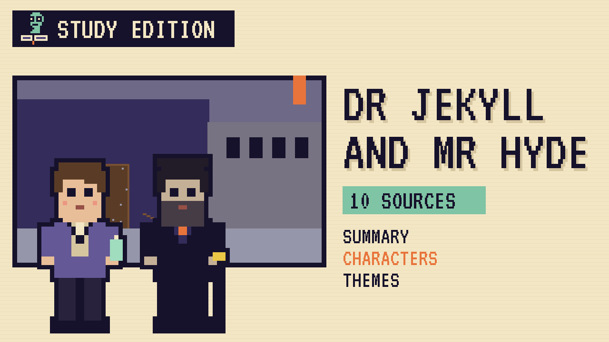

# Dr Jekyll and Mr Hyde
### Unwritten Chapters Study Guide · E16 · "Utterson Keeps the Key"

| | |
|---|---|
| **Author** | Robert Louis Stevenson |
| **Published** | 1886 |
| **Setting** | London, in the late 1800s |
| **Free text** | [Project Gutenberg](https://www.gutenberg.org/ebooks/43) |
| **Study script** | [Read-aloud script](../scripts/E16-dr-jekyll-and-mr-hyde-study-script.md) |
| **Video** | [Watch the 8.5-minute Study Edition](https://www.youtube.com/watch?v=YOUTUBE_ID_E16) · [captions](../captions/E16-dr-jekyll-and-mr-hyde.srt) |

> A respected doctor hides a terrible secret from his oldest friend. This guide covers the novel and a version where Jekyll tells him the truth in time.

## The book in brief

Mr Utterson, a London lawyer, hears a strange story from his cousin, Richard Enfield. Late one night, a man called Edward Hyde knocked down a young girl and walked right over her. To pay her family, he used a cheque signed by the respected Dr Henry Jekyll.

Utterson is worried, because Jekyll's will leaves everything to Hyde. Nearly a year later, Hyde kills an old gentleman, Sir Danvers Carew, in the street and disappears. Then Jekyll shuts himself away, and Utterson sets out to learn why.

## Who's who

- **Mr Utterson**: A serious lawyer and Jekyll's loyal old friend.
- **Dr Jekyll**: A respected doctor and scientist with a hidden side.
- **Mr Hyde**: A small, cruel man who makes everyone who meets him shudder.
- **Dr Lanyon**: Jekyll's old friend, who thinks his science is nonsense.
- **Poole**: Jekyll's faithful butler.

## Big ideas

- **Two sides.** Stevenson suggests every person has a good side and a darker side.
- **Reputation.** Victorian gentlemen hide their secrets to protect their good names.
- **Science and its limits.** Jekyll's experiment goes further than anyone should go.
- **Silence.** Utterson and his friends avoid hard questions, so the secret keeps growing.

## Key quotes

> "man is not truly one, but truly two."  
> — *Strange Case of Dr Jekyll and Mr Hyde*, 1886, chapter 10

*In plain words:* Jekyll says every person has two natures inside them.

> "the moment I choose, I can be rid of Mr. Hyde."  
> — *Strange Case of Dr Jekyll and Mr Hyde*, 1886, chapter 3

*In plain words:* Jekyll is sure he's in control, but he's wrong.

## Words to know

| Word | Meaning |
|---|---|
| respectable | seen by others as decent and proper |
| cabinet | a small private room or study |
| transformation | a complete change in form |
| duality | being made of two opposite parts |

## Our what-if: "Utterson Keeps the Key"

What if Jekyll tells Utterson the whole truth, that night after dinner?

## Discussion questions

1. Why does Jekyll create Hyde in the first place?
2. How does Stevenson use Utterson to tell the story?
3. What does the door with no knocker tell us about Hyde?
4. Is Hyde a separate person, or part of Jekyll? Give reasons.

## Activity

Map the city. Use a Victorian map of London from the British Library to find streets like Soho, where Hyde lived, and compare them with the respectable square where Jekyll's house stands.

## 10 sources: museums, archives and primary sources

| # | Source | Type | Why it's useful |
|---|---|---|---|
| 1 | [The Morgan Library & Museum, Jekyll and Hyde manuscript](https://www.themorgan.org/collection/robert-louis-stevenson/dr-jekyll-and-mr-hyde) | Manuscript | Page images of Stevenson's handwritten manuscript, the copy he sent to his publisher in 1885. |
| 2 | [National Library of Scotland, Stevenson manuscripts](https://digital.nls.uk/rlstevenson/manuscripts.html) | Archive | Stevenson's letters, childhood writing and notebooks from Scotland's national library. |
| 3 | [The Robert Louis Stevenson Website](https://robert-louis-stevenson.org/) | Archive | A free guide to Stevenson's life, works, letters and photographs, from Edinburgh Napier University. |
| 4 | [The Writers' Museum, Edinburgh](https://cultureedinburgh.com/our-venues/writers-museum) | Museum | A free museum in Edinburgh's Old Town with Stevenson's belongings on display. |
| 5 | [Robert Louis Stevenson Museum](https://stevensonmuseum.org/) | Museum | A museum in St. Helena, California, devoted to Stevenson's life and collections. |
| 6 | [Stevenson House, Monterey](https://parks.ca.gov/?page_id=30491) | Historic site | The California house where Stevenson lived for a time in 1879, now part of a state historic park. |
| 7 | [Stevenson in Bournemouth](https://robert-louis-stevenson.org/bournemouth/) | Digital tour | Stevenson's years in Bournemouth, where he lived when Jekyll and Hyde was published. |
| 8 | [1886 first edition scans](https://archive.org/details/strangecaseofdrj00stevrich) | First edition | A scanned copy of the 1886 Longmans, Green first edition. |
| 9 | [LibriVox audiobook](https://librivox.org/the-strange-case-of-jekyll-and-hyde-by-robert-louis-stevenson/) | Audio | A free full-cast dramatic reading of the novel. |
| 10 | [Strange Case of Dr Jekyll and Mr Hyde](https://www.gutenberg.org/ebooks/43) | Free text | The complete novel, free at Project Gutenberg. |

---
*Part of the [Unwritten Chapters Study Guides](../README.md). Free for classroom use under CC BY 4.0.*
