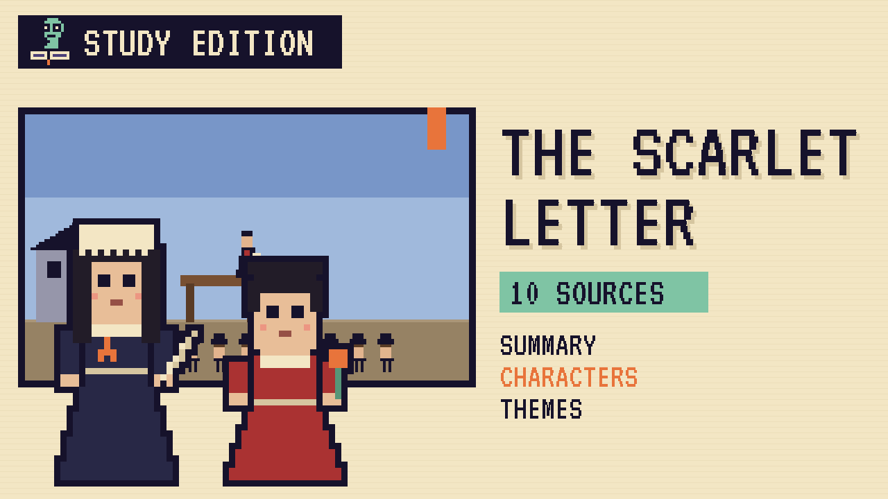

# The Scarlet Letter
### Unwritten Chapters Study Guide · E17 · "Noon on the Scaffold"

| | |
|---|---|
| **Author** | Nathaniel Hawthorne |
| **Published** | 1850 |
| **Setting** | Boston, Massachusetts, 1640s |
| **Free text** | [Project Gutenberg](https://www.gutenberg.org/ebooks/33) |
| **Study script** | [Read-aloud script](../scripts/E17-the-scarlet-letter-study-script.md) |
| **Video** | [Watch the 8.5-minute Study Edition](https://www.youtube.com/watch?v=YOUTUBE_ID_E17) · [captions](../captions/E17-the-scarlet-letter.srt) |

> A young mother must wear a scarlet letter, while her baby's father stays silent. This guide covers the novel and a version where he finally stands beside her in daylight.

## The book in brief

In Puritan Boston in the 1640s, Hester Prynne stands on a wooden scaffold in the marketplace, holding her baby, Pearl. She's been found guilty of adultery, and she must wear a scarlet letter A on her dress for the rest of her life. She refuses to name the baby's father.

In the crowd is her long-missing husband. He takes a new name, Roger Chillingworth, and sets out to find the man. His search leads him to the town's beloved young minister, Arthur Dimmesdale, who is growing sick with a secret.

## Who's who

- **Hester Prynne**: A strong, skilled needlewoman who wears the scarlet A.
- **Pearl**: Her bright, wild little daughter.
- **Arthur Dimmesdale**: The young minister the whole town admires.
- **Roger Chillingworth**: Hester's husband, a doctor bent on revenge.
- **Governor Bellingham**: A stern leader of the colony.

## Big ideas

- **Sin and guilt.** Hidden guilt hurts Dimmesdale far more than public shame hurts Hester.
- **Public judgment.** The Puritan town punishes Hester in front of everyone.
- **Hypocrisy.** The most admired man in town hides the very sin he preaches against.
- **Identity.** Over time, Hester changes what her scarlet A means.

## Key quotes

> "Be true! Be true! Be true! Show freely to the world, if not your worst, yet some trait whereby the worst may be inferred!"  
> — *The Scarlet Letter*, 1850, chapter 24

*In plain words:* The book's big lesson is to be honest about who you really are.

> "Wilt thou stand here with mother and me, tomorrow noontide?"  
> — *The Scarlet Letter*, 1850, chapter 12

*In plain words:* Pearl asks Dimmesdale to stand with them in public, in daylight.

## Words to know

| Word | Meaning |
|---|---|
| scaffold | a raised wooden platform for public punishment |
| ignominy | public shame |
| Puritan | a member of a strict Protestant group in early New England |
| penance | an act done to show sorrow for a wrong |

## Our what-if: "Noon on the Scaffold"

What if Dimmesdale says yes when Pearl asks him to stand with them at noon?

## Discussion questions

1. What does the scarlet A mean at the start of the book, and how does its meaning change?
2. Why does Dimmesdale keep his secret for so long?
3. How does Pearl help reveal the truth?
4. Who is the real sinner in the book? Give reasons.

## Activity

Track the A. List every place the letter A appears in the book, from Hester's dress to the meteor in the sky, and note what it seems to mean each time.

## 10 sources: museums, archives and primary sources

| # | Source | Type | Why it's useful |
|---|---|---|---|
| 1 | [The Morgan Library & Museum, Scarlet Letter title page](https://www.themorgan.org/literary-historical/104171) | Manuscript | Hawthorne's handwritten title page and contents for the novel, said to be all that survives of his manuscript. |
| 2 | [Phillips Library, Peabody Essex Museum](https://pem.quartexcollections.com/collections/hawthorne-collection) | Archive | A collection of more than 3,000 books by and about Hawthorne, with a sampling shown online. |
| 3 | [The House of the Seven Gables](https://7gables.org/salem-beyond/meet-hawthorne-and-friends/) | Historic site | The Salem museum campus that now includes the house where Hawthorne was born. |
| 4 | [Salem Custom House](https://www.nps.gov/places/custom-house.htm) | Historic site | The building where Hawthorne worked, which inspired the novel's opening section. |
| 5 | [The Old Manse](https://home.nps.gov/places/the-old-manse.htm) | Historic site | The Concord house Hawthorne rented with his wife, Sophia, from 1842 to 1845. |
| 6 | [The Wayside](https://nps.gov/mima/learn/historyculture/thewayside.htm) | Historic site | The Concord home Hawthorne's family owned from 1852, now part of a national park. |
| 7 | [Plimoth Patuxet Museums](https://www.plimoth.org/what-see-do/17th-century-english-village) | Museum | A re-created 17th-century English village showing daily life in early New England. |
| 8 | [1850 first edition scans](https://archive.org/details/scarletletterrom01hawt) | First edition | A scanned 1850 copy from Ticknor, Reed, and Fields of Boston, the novel's first publisher. |
| 9 | [LibriVox audiobook](https://librivox.org/the-scarlet-letter-by-nathaniel-hawthorne/) | Audio | A free reading of the whole novel by volunteer narrators. |
| 10 | [The Scarlet Letter](https://www.gutenberg.org/ebooks/33) | Free text | The complete novel, free at Project Gutenberg. |

---
*Part of the [Unwritten Chapters Study Guides](../README.md). Free for classroom use under CC BY 4.0.*
