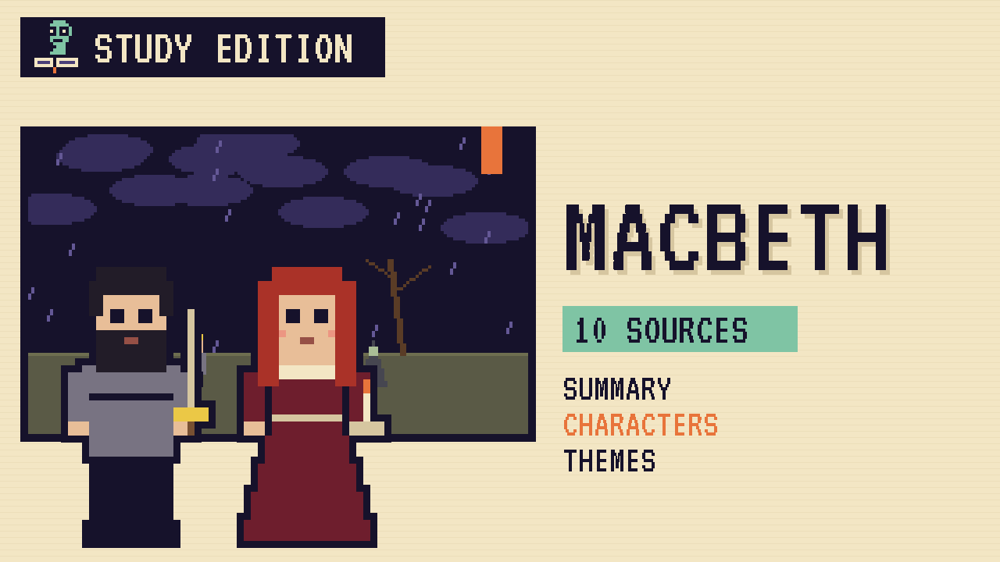

# Macbeth
### Unwritten Chapters Study Guide · E18 · "The King Wakes Up"

| | |
|---|---|
| **Author** | William Shakespeare |
| **Published** | 1606 |
| **Setting** | Scotland, the eleventh century |
| **Free text** | [Project Gutenberg](https://www.gutenberg.org/ebooks/1533) |
| **Study script** | [Read-aloud script](../scripts/E18-macbeth-study-script.md) |
| **Video** | [Watch the 8.5-minute Study Edition](https://www.youtube.com/watch?v=YOUTUBE_ID_E18) · [captions](../captions/E18-macbeth.srt) |

> Three witches tell a brave Scottish general that he'll be king. This guide covers the play and a version where Macbeth says no to murder, and means it.

## The book in brief

After winning a great battle for King Duncan, the Scottish general Macbeth meets three witches on a heath. They greet him as Thane of Cawdor, and as the man who will be king. Moments later, messengers arrive to say the king has made him Thane of Cawdor.

Macbeth writes to his wife, and Lady Macbeth is sure the rest must come true. When King Duncan comes to stay at their castle, she urges her husband to kill him in his sleep.

## Who's who

- **Macbeth**: A brave general who's tempted by power.
- **Lady Macbeth**: His wife, even more ambitious than he is.
- **King Duncan**: The kind, trusting king of Scotland.
- **Banquo**: Macbeth's fellow general and friend.
- **Macduff**: The loyal Thane of Fife.
- **The witches**: Three strange sisters who seem to know the future.

## Big ideas

- **Ambition.** Macbeth's hunger for power drives him to murder.
- **Fate and free will.** The witches predict the future, but Macbeth chooses how to act.
- **Guilt.** Blood and lost sleep haunt both Macbeths after the murder.
- **Appearance and reality.** Things that look fair can be foul, and people hide what they really intend.

## Key quotes

> "We will proceed no further in this business"  
> — *Macbeth*, 1606, act 1, scene 7

*In plain words:* Macbeth tries to back out of the plan to kill the king.

> "Out, damned spot! out, I say!"  
> — *Macbeth*, 1606, act 5, scene 1

*In plain words:* Lady Macbeth, sleepwalking, tries to scrub away blood only she can see.

## Words to know

| Word | Meaning |
|---|---|
| thane | a Scottish lord who holds land from the king |
| ambition | a strong wish for power or success |
| regicide | the killing of a king |
| prophecy | a prediction of what will happen |

## Our what-if: "The King Wakes Up"

What if Macbeth sticks to his decision and refuses to kill King Duncan?

## Discussion questions

1. How do the witches' predictions change Macbeth?
2. Who is more to blame for Duncan's murder, Macbeth or Lady Macbeth?
3. How does guilt show itself in the play?
4. Why does Banquo react differently to the witches?

## Activity

Follow the blood. Find every mention of blood in the play and note who says it and what it shows about their guilt.

## 10 sources: museums, archives and primary sources

| # | Source | Type | Why it's useful |
|---|---|---|---|
| 1 | [The Bodleian First Folio](https://firstfolio.bodleian.ox.ac.uk/about.html) | First edition | A free digital copy of the 1623 First Folio, where Macbeth was first printed. |
| 2 | [Folger Shakespeare Library](https://www.folger.edu/explore/shakespeares-works/macbeth/) | Archive | The play's free text, essays, images from the collection and a filmed production. |
| 3 | [Shakespeare's Birthplace](https://www.shakespeare.org.uk/visit/shakespeares-birthplace/) | Historic site | The house in Stratford-upon-Avon where Shakespeare grew up. |
| 4 | [Shakespeare's Globe](https://www.shakespearesglobe.com/discover/shakespeares-plays/macbeth/) | Historic site | The rebuilt Globe Theatre in London, with a guide to Macbeth and its past productions. |
| 5 | [RSC Shakespeare Learning Zone](https://www.rsc.org.uk/shakespeare-learning-zone/macbeth/story/scene-by-scene) | Digital tour | The Royal Shakespeare Company's scene-by-scene guide to the play. |
| 6 | [Holinshed's Chronicles](https://shakespeare-navigators.ewu.edu/macbeth/Holinshed/index.html) | Archive | Passages from the history book Shakespeare used as his main source. |
| 7 | [Glamis Castle](https://www.historichouses.org/house/glamis-castle/) | Historic site | The Scottish castle linked with Macbeth's first title, Thane of Glamis. |
| 8 | [Daemonologie, by King James](https://www.gutenberg.org/ebooks/25929) | Free text | King James's 1597 book about witches, free at Project Gutenberg. |
| 9 | [LibriVox audiobook](https://librivox.org/the-tragedy-of-macbeth-by-william-shakespeare/) | Audio | A free full-cast dramatic reading of the play. |
| 10 | [Macbeth](https://www.gutenberg.org/ebooks/1533) | Free text | The complete play, free at Project Gutenberg. |

---
*Part of the [Unwritten Chapters Study Guides](../README.md). Free for classroom use under CC BY 4.0.*
