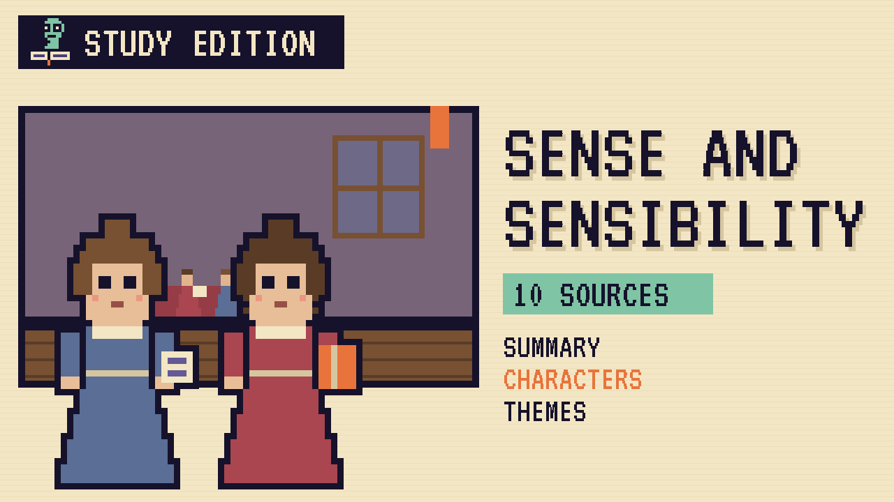

# Sense and Sensibility
### Unwritten Chapters Study Guide · E29 · "The Walk at Cleveland"

| | |
|---|---|
| **Author** | Jane Austen |
| **Published** | 1811 |
| **Setting** | Sussex, Devonshire, London and Somerset |
| **Free text** | [Project Gutenberg](https://www.gutenberg.org/ebooks/161) |
| **Study script** | [Read-aloud script](../scripts/E29-sense-and-sensibility-study-script.md) |
| **Video** | [Watch the 8.5-minute Study Edition](https://www.youtube.com/watch?v=YOUTUBE_ID_E29) · [captions](../captions/E29-sense-and-sensibility.srt) |

> Two sisters, one sensible and one full of feeling, both lose the man they love. This guide covers the novel and a version where Elinor follows Marianne on her lonely evening walk.

## The book in brief

When Mr Dashwood dies, his home, Norland Park in Sussex, goes to his son John. John promised his dying father he'd help his stepmother and half-sisters. But his wife, Fanny, talks him out of giving them almost anything. So Mrs Dashwood and her daughters Elinor, Marianne and Margaret move to a small cottage in Devonshire.

Calm, sensible Elinor loves Fanny's brother, Edward Ferrars, but learns he's been secretly engaged to Lucy Steele for four years. Passionate Marianne falls for the dashing John Willoughby, who drops her to marry a rich young woman. Each sister has to find her own way through heartbreak.

## Who's who

- **Elinor Dashwood**: The eldest sister, calm and sensible, who keeps her feelings to herself.
- **Marianne Dashwood**: Her younger sister, romantic and honest, who feels everything deeply.
- **Edward Ferrars**: Fanny's shy, good-hearted brother, who loves Elinor.
- **John Willoughby**: A handsome, charming young man who sweeps Marianne off her feet.
- **Colonel Brandon**: A quiet, kind older friend who loves Marianne.
- **Lucy Steele**: A sly young woman with a secret.

## Big ideas

- **Sense and sensibility.** Elinor's good sense and Marianne's strong feelings both matter, and each sister learns from the other.
- **Money and marriage.** Women like the Dashwoods had little money and few ways to earn it, so marriage often decided their future.
- **Secrets and honesty.** Lucy's secret engagement causes much of the pain.
- **Sisters.** Elinor and Marianne's love for each other holds the whole story together.

## Key quotes

> "her feelings were strong; but she knew how to govern them"  
> — *Sense and Sensibility*, 1811, chapter 1

*In plain words:* Austen tells us Elinor feels deeply, but she keeps her feelings under control.

> "her sorrows, her joys, could have no moderation"  
> — *Sense and Sensibility*, 1811, chapter 1

*In plain words:* Marianne can't do anything by halves, whether she's happy or sad.

## Words to know

| Word | Meaning |
|---|---|
| sensibility | strong feeling and emotion |
| sense | good judgment and self-control |
| inheritance | money or property passed down when someone dies |
| engagement | a promise to marry |

## Our what-if: "The Walk at Cleveland"

Elinor follows Marianne on her lonely evening walk at Cleveland

## Discussion questions

1. How are Elinor and Marianne different, and how do they each change?
2. Why does Willoughby leave Marianne?
3. How does Elinor cope with Edward's secret engagement?
4. Does the book prefer sense or sensibility? Give reasons.

## Activity

Two sisters, two diaries. Write one short diary entry by Elinor and one by Marianne about the same day, such as Willoughby's last visit, and show how each sister feels.

## 10 sources: museums, archives and primary sources

| # | Source | Type | Why it's useful |
|---|---|---|---|
| 1 | [Jane Austen's House: first edition of *Sense and Sensibility*](https://janeaustens.house/object/sense-and-sensibility/) | Museum | A rare 1811 copy in its original blue boards, with the story of how the book was published. |
| 2 | [1811 first edition scans](https://archive.org/details/sensesensibility131aust) | First edition | All three volumes of the first edition, "By a Lady", from Duke University Libraries. |
| 3 | [Chawton House: the collection](https://chawtonhouse.org/2020/04/curator-chawton-house-collection/) | Historic site | Her brother Edward's house in Chawton, now home to a library of early women's writing. |
| 4 | [The Morgan Library & Museum: *A Lively Mind*](https://www.themorgan.org/exhibitions/lively-mind-jane-austen-250) | Museum | An Austen exhibition with an 1811 volume of the novel and illustrations for it. |
| 5 | [National Portrait Gallery: *Jane Austen* by Cassandra Austen](https://www.npg.org.uk/collections/search/portrait/mw00230) | Museum | The small pencil and watercolour sketch of Jane by her sister, about 1810. |
| 6 | [Jane Austen Society of North America: *Sense and Sensibility*](https://jasna.org/austen/works/sense-sensibility/) | Archive | Dates, essays, discussion questions and a map of the novel's places. |
| 7 | [10 Virtual Tours for Lovers of Jane Austen](https://artsandculture.google.com/theme/10-virtual-tours-for-lovers-of-jane-austen/wALyslg9JF3OJA?hl=en) | Digital tour | Google Arts & Culture tours of Austen places, including Montacute House from the 1995 film. |
| 8 | [Winchester Cathedral](https://www.winchester-cathedral.org.uk/hampshire-celebrates-250-years-of-jane-austen/) | Historic site | Where Jane Austen is buried, in the north aisle of the nave. |
| 9 | [LibriVox audiobook](https://librivox.org/sense-and-sensibility-by-jane-austen/) | Audio | A free volunteer recording of the full novel. |
| 10 | [*Sense and Sensibility* (free text)](https://www.gutenberg.org/ebooks/161) | Free text | The complete novel. |

---
*Part of the [Unwritten Chapters Study Guides](../README.md). Free for classroom use under CC BY 4.0.*
