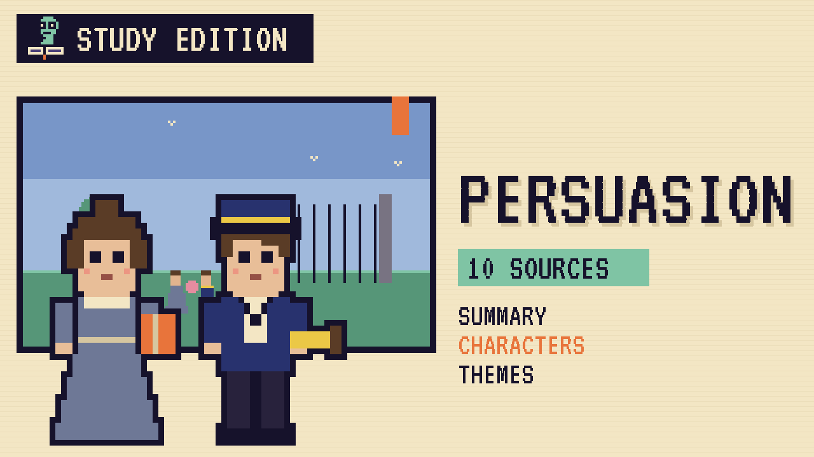

# Persuasion
### Unwritten Chapters Study Guide · E30 · "A Letter in 1808"

| | |
|---|---|
| **Author** | Jane Austen |
| **Published** | 1817 |
| **Setting** | Somerset, Lyme and Bath, 1814 to 1815 |
| **Free text** | [Project Gutenberg](https://www.gutenberg.org/ebooks/105) |
| **Study script** | [Read-aloud script](../scripts/E30-persuasion-study-script.md) |
| **Video** | [Watch the 8.5-minute Study Edition](https://www.youtube.com/watch?v=YOUTUBE_ID_E30) · [captions](../captions/E30-persuasion.srt) |

> Anne Elliot gave up the man she loved when she was nineteen. This guide covers Austen's last finished novel and a version where Captain Wentworth writes to her two years later.

## The book in brief

Sir Walter Elliot is a vain baronet who has spent too much money. To save it, he rents out his home, Kellynch Hall in Somerset, and moves to Bath. His middle daughter, Anne, is twenty-seven. She's kind and sensible, but her family barely notices her.

Eight years before, Anne was engaged to a young naval officer, Frederick Wentworth. Her friend Lady Russell persuaded her to break it off, because he had no money. Now he's back, a rich captain, and his sister and her husband, Admiral and Mrs Croft, are renting Kellynch.

## Who's who

- **Anne Elliot**: Gentle, clever and overlooked, and still in love with Wentworth.
- **Captain Frederick Wentworth**: A brave, proud naval captain who made his fortune at sea.
- **Lady Russell**: Anne's wise older friend, who persuaded her to give him up.
- **Sir Walter Elliot**: Anne's vain father, who loves his looks and his title.
- **Louisa Musgrove**: A lively young woman whom Wentworth seems to admire.
- **Mr William Elliot**: Anne's charming cousin, the heir to Kellynch.

## Big ideas

- **Persuasion.** Anne followed advice that turned out to be wrong, and the novel asks when we should listen to others.
- **Second chances.** Love can last through years apart, and it's never too late to try again.
- **Rank and the navy.** Self-made sailors like Wentworth earn respect, while Sir Walter only has an old title.
- **Being overlooked.** Anne's family ignores her, but she's often the wisest person in the room.

## Key quotes

> "She had been forced into prudence in her youth, she learned romance as she grew older: the natural sequel of an unnatural beginning."  
> — *Persuasion*, 1817, chapter 4

*In plain words:* Anne was made to be careful when she was young, so she grew more romantic as she got older.

> "You pierce my soul. I am half agony, half hope."  
> — *Persuasion*, 1817, chapter 23

*In plain words:* Wentworth's letter tells Anne that he still loves her.

## Words to know

| Word | Meaning |
|---|---|
| persuasion | convincing someone to do or believe something |
| prudence | careful good sense about the future |
| baronet | a title just below a lord, passed from father to son |
| constancy | staying faithful over time |

## Our what-if: "A Letter in 1808"

Captain Wentworth writes to Anne in 1808, when he comes home with a ship and some money

## Discussion questions

1. Was Anne right to listen to Lady Russell at nineteen? Give reasons.
2. How has Wentworth changed in the eight years apart?
3. What does the fall at Lyme teach Wentworth?
4. Why is the navy important in Persuasion?

## Activity

Read the letter. Find Captain Wentworth's letter in chapter 23 and underline every line that shows his feelings have stayed the same for eight years.

## 10 sources: museums, archives and primary sources

| # | Source | Type | Why it's useful |
|---|---|---|---|
| 1 | [Jane Austen's Fiction Manuscripts: *Persuasion*](https://janeausten.ac.uk/edition/ms/PersuasionHeadNote.html) | Manuscript | Austen's handwritten cancelled chapters of *Persuasion*, dated July 1816, page by page. |
| 2 | [British Library: Jane Austen at 250](https://www.bl.uk/stories/blogs/posts/jane-austen-at-250) | Archive | A curator's guide to the Library's Austen treasures, including the *Persuasion* manuscript. |
| 3 | [Jane Austen's House: first edition of *Northanger Abbey* and *Persuasion*](https://janeaustens.house/object/first-edition-northanger-abbey-and-persuasion/) | Museum | A family copy from the cottage in Chawton where she wrote *Persuasion*. |
| 4 | [The Morgan Library & Museum: 1818 first edition](https://www.themorgan.org/printed-books/77558) | First edition | The Morgan's four-volume set of *Northanger Abbey* and *Persuasion*. |
| 5 | [Lyme Regis and the Cobb](https://www.visit-dorset.com/lyme-regis/explore-discover/history-heritage/jane-austen/) | Historic site | Austen's visits to Lyme and the steps on the Cobb where Louisa falls. |
| 6 | [Bath Assembly Rooms (National Trust)](https://www.nationaltrust.org.uk/visit/bath-bristol/bath-assembly-rooms/jane-austen-at-bath-assembly-rooms) | Historic site | The Upper Rooms, where Anne and Wentworth meet at the concert. |
| 7 | [Jane Austen Centre, Bath: Bath through Austen's eyes](https://janeausten.co.uk/blogs/from-the-jane-austen-centre/baths-persuasion) | Museum | A walk round the real Bath streets and rooms of *Persuasion*. |
| 8 | [Royal Museums Greenwich: Jane Austen and the Royal Navy](https://www.rmg.co.uk/stories/maritime-history/library-archive/jane-austen-royal-navy) | Museum | Austen's sailor brothers, and the navy behind *Persuasion*. |
| 9 | [LibriVox audiobook](https://librivox.org/persuasion-by-jane-austen-2/) | Audio | A free recording of the full novel, read by Elizabeth Klett. |
| 10 | [*Persuasion* (free text)](https://www.gutenberg.org/ebooks/105) | Free text | The complete novel. |

---
*Part of the [Unwritten Chapters Study Guides](../README.md). Free for classroom use under CC BY 4.0.*
