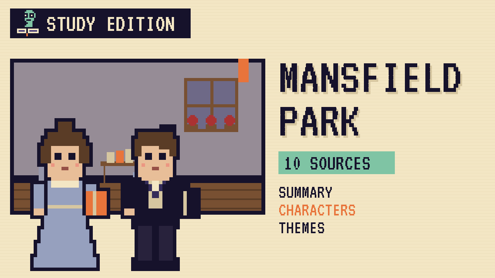

# Mansfield Park
### Unwritten Chapters Study Guide · E31 · "Fanny Finishes Her Sentence"

| | |
|---|---|
| **Author** | Jane Austen |
| **Published** | 1814 |
| **Setting** | Northamptonshire and Portsmouth, early 1800s |
| **Free text** | [Project Gutenberg](https://www.gutenberg.org/ebooks/141) |
| **Study script** | [Read-aloud script](../scripts/E31-mansfield-park-study-script.md) |
| **Video** | [Watch the 8.5-minute Study Edition](https://www.youtube.com/watch?v=YOUTUBE_ID_E31) · [captions](../captions/E31-mansfield-park.srt) |

> Fanny Price is the quiet poor relation at Mansfield Park, and nobody waits to hear what she thinks. This guide covers the novel and a version where Edmund lets her finish her sentence.

## The book in brief

Fanny Price is ten when she's sent from her crowded home in Portsmouth to live with rich relatives at Mansfield Park. Her bossy aunt, Mrs Norris, never lets her forget she's the poor relation. Only her cousin Edmund treats her with real kindness.

Years later, while her uncle, Sir Thomas, is away at his estate in Antigua, the charming Crawfords arrive from London. The young people decide to put on a daring play called Lovers' Vows. Edmund falls for the witty Mary Crawford, while Fanny quietly watches and refuses to act.

## Who's who

- **Fanny Price**: Shy and gentle, but quietly firm about what's right.
- **Edmund Bertram**: Her kind cousin, who plans to become a clergyman.
- **Sir Thomas Bertram**: Her stern uncle, the owner of Mansfield Park.
- **Mrs Norris**: Her bossy aunt, who is always unkind to her.
- **Mary Crawford**: A lively, witty young woman from London.
- **Henry Crawford**: Mary's charming brother, who loves to flirt.

## Big ideas

- **Conscience.** Fanny's quiet sense of right holds firm when everyone pushes her.
- **Charm and principle.** The Crawfords are clever and fun, but they lack firm principles.
- **Upbringing.** Sir Thomas taught his daughters fine manners, but not how to be good.
- **Home and belonging.** The poor relation slowly becomes the heart of Mansfield.

## Key quotes

> "No, indeed, I cannot act."  
> — *Mansfield Park*, 1814, chapter 15

*In plain words:* Fanny refuses to take a part in the play, however hard they push.

> "We have all a better guide in ourselves, if we would attend to it, than any other person can be."  
> — *Mansfield Park*, 1814, chapter 42

*In plain words:* Fanny tells Henry Crawford to follow his own conscience, not her advice.

## Words to know

| Word | Meaning |
|---|---|
| clergyman | a priest or minister in the church |
| propriety | correct and proper behaviour |
| estate | a large country house and its land |
| principle | a firm belief about right and wrong |

## Our what-if: "Fanny Finishes Her Sentence"

Edmund waits for Fanny to finish her sentence

## Discussion questions

1. Why does Fanny refuse to act in the play?
2. How does Mansfield Park change Fanny, and how does Fanny change Mansfield Park?
3. Why does Fanny turn down Henry Crawford?
4. Is Fanny weak or strong? Give reasons.

## Activity

Map the house. Draw a plan of Mansfield Park's rooms, from the East room to the billiard room, and mark where each key scene happens.

## 10 sources: museums, archives and primary sources

| # | Source | Type | Why it's useful |
|---|---|---|---|
| 1 | [Jane Austen's Fiction Manuscripts: *Opinions of Mansfield Park*](https://janeausten.ac.uk/edition/ms/OpinionsHeadNote.html) | Manuscript | Austen's own list of what family and friends thought of the novel, held at the British Library. |
| 2 | [Jane Austen's House, Chawton: *Mansfield Park*](https://janeaustens.house/jane-austen/novels/mansfield-park/) | Museum | The cottage museum where Austen wrote the novel between 1811 and 1813. |
| 3 | [Stoneleigh Abbey](https://www.stoneleighabbey.uk/) | Historic site | The Warwickshire home of Austen's Leigh cousins, which she visited in 1806. |
| 4 | [Portsmouth Historic Dockyard](https://historicdockyard.co.uk/) | Historic site | The naval dockyard of Fanny's home town, with HMS Victory and the Royal Navy museums. |
| 5 | [Royal Museums Greenwich: Jane Austen and the Royal Navy](https://www.rmg.co.uk/stories/maritime-history/library-archive/jane-austen-royal-navy) | Museum | How Austen's sailor brothers shaped her navy characters, including William Price. |
| 6 | [*Lovers' Vows*, 1798](https://archive.org/download/loversvowsplayin00kotzuoft/loversvowsplayin00kotzuoft.pdf) | Archive | Elizabeth Inchbald's version of Kotzebue's play, the one the young people rehearse. |
| 7 | [The Morgan Library & Museum: *A Woman's Wit*](https://www.themorgan.org/collection/a-womans-wit-jane-austen) | Digital tour | An online exhibition of Austen's letters, manuscripts and drawings. |
| 8 | [1814 first edition scans](https://archive.org/details/mansfieldparknov01aust) | First edition | Volume one of the 1814 edition, printed for Thomas Egerton. |
| 9 | [LibriVox audiobook](https://librivox.org/mansfield-park-by-jane-austen/) | Audio | A free volunteer recording of the full novel. |
| 10 | [*Mansfield Park* (free text)](https://www.gutenberg.org/ebooks/141) | Free text | The complete novel in English. |

---
*Part of the [Unwritten Chapters Study Guides](../README.md). Free for classroom use under CC BY 4.0.*
