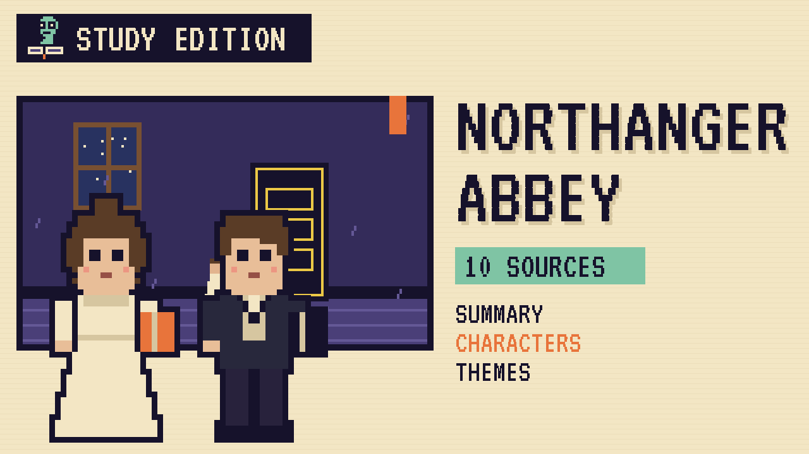

# Northanger Abbey
### Unwritten Chapters Study Guide · E32 · "The Washing Bill"

| | |
|---|---|
| **Author** | Jane Austen |
| **Published** | 1817 |
| **Setting** | Bath and Gloucestershire, late 1790s |
| **Free text** | [Project Gutenberg](https://www.gutenberg.org/ebooks/121) |
| **Study script** | [Read-aloud script](../scripts/E32-northanger-abbey-study-script.md) |
| **Video** | [Watch the 8.5-minute Study Edition](https://www.youtube.com/watch?v=YOUTUBE_ID_E32) · [captions](../captions/E32-northanger-abbey.srt) |

> Catherine Morland has read so many spooky novels that she expects every old abbey to hide a secret. This guide covers Austen's comedy and a version where Catherine tells Henry about her midnight discovery.

## The book in brief

Catherine Morland is seventeen, a clergyman's daughter who loves thrilling Gothic novels. She goes to Bath with her neighbours, the Allens. There she meets the clever, teasing Henry Tilney and his gentle sister Eleanor. She also meets the boastful John Thorpe and his showy sister Isabella.

Henry's father, General Tilney, invites Catherine to stay at Northanger Abbey, the family home. Catherine hopes the old abbey hides dark secrets, like the castles in her books. Soon she starts to suspect the General of something terrible.

## Who's who

- **Catherine Morland**: A kind, honest girl who loves Gothic novels.
- **Henry Tilney**: A witty young clergyman who loves to tease.
- **Eleanor Tilney**: Henry's gentle sister, who becomes Catherine's true friend.
- **General Tilney**: Their stern, proud father.
- **Isabella Thorpe**: Catherine's gushing new friend in Bath.
- **John Thorpe**: Isabella's brother, who brags and tells lies.

## Big ideas

- **Fiction and reality.** Catherine learns that real life isn't a Gothic novel.
- **Growing up.** Catherine learns to trust her own judgement about people.
- **True and false friends.** Isabella's sweet words hide selfish aims, while the Tilneys are sincere.
- **Money and marriage.** The General and the Thorpes care more about fortune than feelings.

## Key quotes

> "No one who had ever seen Catherine Morland in her infancy would have supposed her born to be an heroine."  
> — *Northanger Abbey*, 1817, chapter 1

*In plain words:* Austen jokes that Catherine seems far too ordinary to be a heroine.

> "The person, be it gentleman or lady, who has not pleasure in a good novel, must be intolerably stupid."  
> — *Northanger Abbey*, 1817, chapter 14

*In plain words:* Henry stands up for novels and says anyone who can't enjoy them is dull.

## Words to know

| Word | Meaning |
|---|---|
| Gothic | a style of novel full of old castles, secrets and fear |
| parody | a work that copies a style to make fun of it |
| abbey | a building that was once a home for monks or nuns |
| imagination | the power to picture things that aren't there |

## Our what-if: "The Washing Bill"

Catherine tells Henry the truth about the black cabinet

## Discussion questions

1. How does Austen make fun of Gothic novels?
2. What does Catherine learn at Northanger Abbey?
3. How is Isabella Thorpe different from Eleanor Tilney?
4. Is General Tilney a real villain? Give reasons.

## Activity

Gothic or real? List five moments where Catherine imagines something frightening, and next to each write what was really going on.

## 10 sources: museums, archives and primary sources

| # | Source | Type | Why it's useful |
|---|---|---|---|
| 1 | [The Morgan Library & Museum: Jane Austen's Letters](https://www.themorgan.org/collection/jane-austen/letters) | Manuscript | Austen's letters in her own hand, including one she wrote from Bath in June 1799. |
| 2 | [Jane Austen Centre, Bath](https://janeausten.co.uk/) | Museum | A Georgian townhouse museum about Austen's years in Bath. |
| 3 | [National Trust: Jane Austen at Bath Assembly Rooms](https://www.nationaltrust.org.uk/visit/bath-bristol/bath-assembly-rooms/jane-austen-at-bath-assembly-rooms) | Historic site | The ballrooms where Catherine dances, closed for renovation until 2027. |
| 4 | [The Roman Baths and Pump Room](https://www.romanbaths.co.uk/) | Historic site | The Pump Room where Bath society met each day, above the Roman baths. |
| 5 | [The Holburne Museum](https://www.holburne.org/) | Museum | Bath's first art museum, in Sydney Gardens, across the road from Austen's home at 4 Sydney Place. |
| 6 | [Google Arts & Culture: 10 Virtual Tours for Lovers of Jane Austen](https://artsandculture.google.com/story/xQXxslg9JF3OJA) | Digital tour | Street View tours of Austen places, including Sydney Place in Bath. |
| 7 | [British Library: Jane Austen and the very horrid *Northanger Abbey*](https://www.bl.uk/stories/blogs/posts/jane-austen-and-the-very-horrid-northanger-abbey) | Archive | The real Gothic novels on Isabella's list of "horrid" books. |
| 8 | [1817 first edition scans](https://archive.org/details/northangerabbeyp141aust) | First edition | The first edition with *Persuasion*, from John Murray, dated 1818 on its title page. |
| 9 | [LibriVox audiobook](https://librivox.org/northanger-abbey-by-jane-austen/) | Audio | A free volunteer recording of the full novel. |
| 10 | [*Northanger Abbey* (free text)](https://www.gutenberg.org/ebooks/121) | Free text | The complete novel in English. |

---
*Part of the [Unwritten Chapters Study Guides](../README.md). Free for classroom use under CC BY 4.0.*
